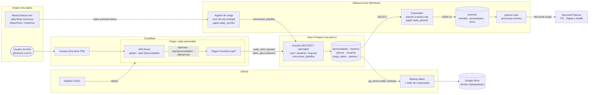
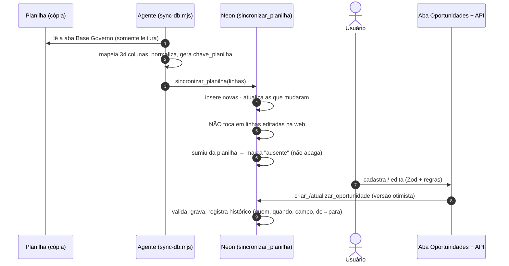
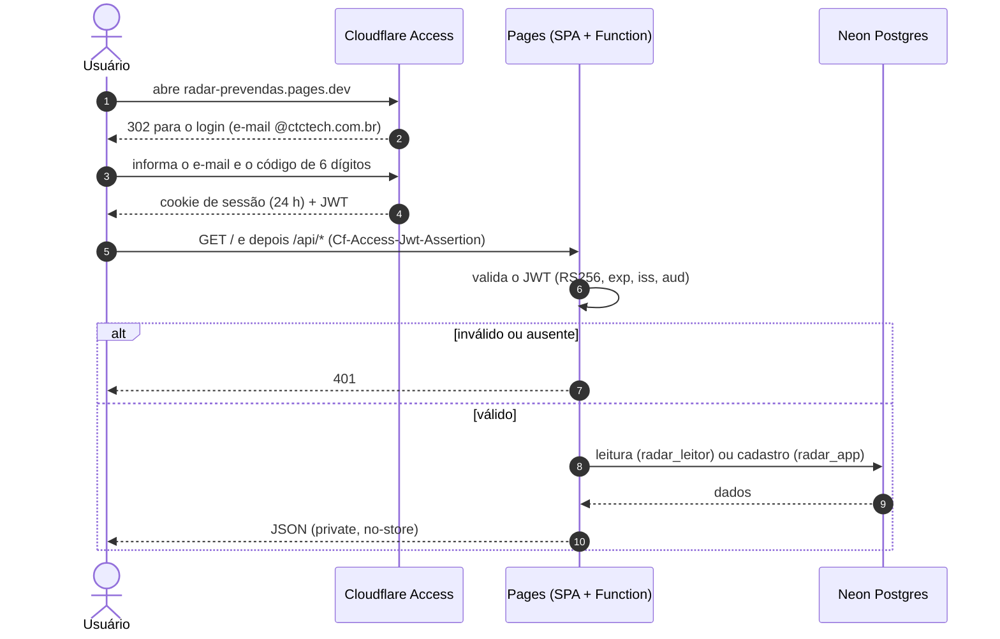
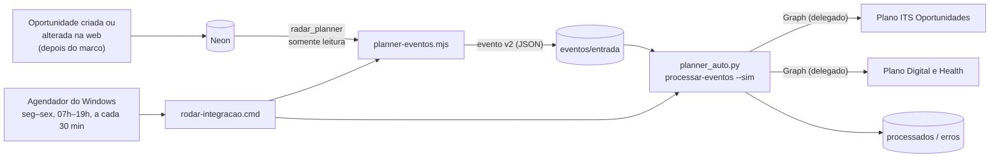
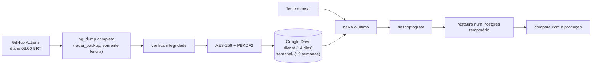
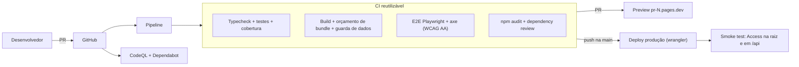
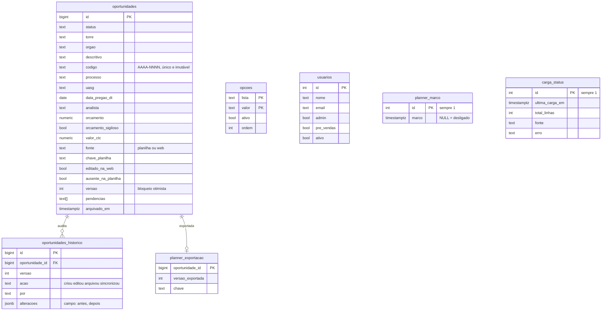

# Arquitetura do Radar Pré-Vendas

Painel interno de pré-vendas (licitações) **e** cadastro de oportunidades. O banco **Postgres (Neon)** é a fonte da verdade: ele é alimentado de duas formas (a planilha *BaseLicitacao.xlsx*, por merge, e o cadastro direto na aba **Oportunidades**) e alimenta o painel de métricas, o backup e o Microsoft Planner. Tudo atrás do **Cloudflare Access** (código por e-mail `@ctctech.com.br`).

A operação do dia a dia está em [OPERACAO.md](OPERACAO.md); o que vem a seguir está em [ROADMAP.md](ROADMAP.md).

## 1. Visão geral

**Ideia central:** cada componente tem um papel de banco com o **mínimo de privilégio** e só consegue o que precisa. Quem lê não escreve; quem exporta para o Planner só lê; quem faz backup só lê; quem cadastra só chama funções que validam e auditam.

## 2. Duas portas de entrada de dados (convivência planilha ↔ web)

Regras de projeto:
- **A edição na web vence a planilha.** Linhas com `editado_na_web` ou `fonte = 'web'` nunca são sobrescritas pela carga.
- **Nada é apagado:** linha que sumiu da planilha vira `ausente_na_planilha` (o painel e a grade a ignoram); "excluir" na web é **arquivar** (só administrador, reversível).
- **Código da oportunidade** (`codigo`, `AAAA-NNNN`): identificador de negócio, único e imutável, numerado por ano da data do pregão. É o mesmo código mostrado no Radar e no título do cartão do Planner. A planilha **não** recebe o código (ela será desativada).
- **Chave de sincronização** (`chave_planilha`) = processo + órgão + data do pregão + torre. Se alguém corrigir um desses campos na planilha, o banco enxerga uma linha nova e marca a antiga como ausente (limitação conhecida; ver [ROADMAP.md](ROADMAP.md)).
- **Trava de segurança:** o agente recusa a carga se vierem menos de 400 linhas (leitura parcial marcaria o resto como ausente).
- A carga total antiga (`carregar_oportunidades`) é **bloqueada pelo banco** se existir qualquer linha criada pela web.

Detalhes: [AGENTE-DE-CARGA.md](AGENTE-DE-CARGA.md), [CARGA-DE-DADOS.md](CARGA-DE-DADOS.md), [CADASTRO-OPORTUNIDADES.md](CADASTRO-OPORTUNIDADES.md).

## 3. Cadastro pela web (API)

| Rota | Método | Quem | O que faz |
|---|---|---|---|
| `/api/rows`, `/api/status` | GET | qualquer usuário autenticado | dados do painel (papel `radar_leitor`) |
| `/api/me` | GET | autenticado | e-mail, nome, se é admin |
| `/api/opcoes` | GET / PUT | todos leem; **admin** altera | listas fechadas e pré-vendas |
| `/api/usuarios` | PUT | **admin** | usuários, papéis e e-mails |
| `/api/oportunidades` | GET / POST | todos | grade e cadastro (aviso de duplicata) |
| `/api/oportunidades/:id` | GET / PUT | todos | leitura e edição com versão otimista (409 em conflito) |
| `/api/oportunidades/:id/historico` | GET | todos | trilha de alterações |
| `/api/oportunidades/:id/arquivar` · `/restaurar` | POST | **admin** | exclusão lógica reversível |

Camadas de proteção:
1. **Borda:** Cloudflare Access (domínio `@ctctech.com.br`).
2. **API:** valida o JWT do Access por conta própria (assinatura RS256, `exp`, `iss`, `aud`) em qualquer endereço do projeto; o **autor** vem do e-mail do JWT, nunca do corpo da requisição.
3. **CSRF:** escritas exigem o cabeçalho `x-radar-csrf` e `Origin` igual ao host.
4. **Formato:** esquema Zod compartilhado entre navegador e API (`src/domain/oportunidade.ts`), descartando campos desconhecidos.
5. **Regras de negócio no banco:** `validar_oportunidade` (obrigatórios, listas fechadas, Lost/No Go com motivo, Win com Valor CTC, datas, valores) — a **fonte da verdade** da validação; erros voltam campo a campo (HTTP 422).
6. **Banco:** a API usa `radar_app`, que só executa as funções de cadastro (não faz `INSERT` direto).
7. **Cabeçalhos:** CSP restritiva, `X-Frame-Options: DENY`, HSTS e `noindex`.

## 4. Acesso do usuário (login → dados)

## 5. Integração com o Microsoft Planner

- **Sentido único** (Radar → Planner). Só oportunidades **criadas na web depois da ativação**; as vindas da planilha nunca são enviadas.
- **Torre → plano:** ITS vai para *ITS Oportunidades*; DIGITAL e HEALTH vão para *Digital e Health*.
- **Status → bucket e progresso**; **Pré-vendas → responsável** (e-mail cadastrado em *Listas e usuários*); título `[AAAA-NNNN] Órgão | Objeto | PE | UASG | DATA` (o **código da oportunidade**).
- **Idempotente e conservador:** a chave (o código `AAAA-NNNN`) evita duplicar; versão antiga é ignorada; responsável vazio não mexe; nunca apaga cartão nem arquivo; erro vai para `erros\` com o motivo.

Contrato completo e mapeamentos: [INTEGRACAO-PLANNER.md](INTEGRACAO-PLANNER.md).

## 6. Backup e restauração

Runbook e restauração: [BACKUP.md](BACKUP.md).

## 7. Entrega (código → produção)

- Build de **produção** sem fallback sintético: API fora do ar vira erro visível.
- **Rollback:** *Actions → Pipeline → Run workflow* com `ref` = commit anterior.
- Dependabot não propõe *major* do `@tanstack/react-table` (a grade usa a v8).

## 8. Modelo de dados e privilégios

(A tabela `oportunidades` tem ~55 colunas: as 34 da planilha, as derivadas `ano`, `mes`, `sla`, e os metadados de auditoria. Esquema completo em [`db/migrations/`](../db/migrations/).)

| Papel | Quem usa | Pode | Não pode |
|---|---|---|---|
| `radar_leitor` | API do painel | `SELECT` nas tabelas de leitura | escrever, apagar, executar carga |
| `radar_app` | API de cadastro | `SELECT` + `EXECUTE` das funções de cadastro | `INSERT` direto, sincronizar planilha |
| `radar_escritor` | Agente de carga | `EXECUTE sincronizar_planilha` | ler tabelas, apagar, alterar esquema |
| `radar_planner` | Exportador do Planner | `SELECT` em oportunidades e usuários; grava só nas tabelas `planner_*` | alterar oportunidades |
| `radar_backup` | Backup diário | leitura de tudo (`pg_read_all_data`) | gravar |
| `neondb_owner` | Administração (console/CLI) | tudo | — (uso excepcional) |

As funções de cadastro são `SECURITY DEFINER`: rodam com o privilégio do dono, então os papéis acima não precisam de acesso direto às tabelas para escrever.

## 9. Inventário de componentes

| Componente | Onde | Identificação |
|---|---|---|
| Planilha | SharePoint GOVERNO2 | `BaseLicitacao.xlsx`, aba *Base Governo* (~610 linhas, 39 colunas; as 6 "(Pivot)" são auxiliares e ignoradas) |
| Agente de carga | máquina local do João | tarefa `RadarPreVendas-Carga` (a cada 2 dias) |
| Integração Planner | máquina local do João | tarefa `Radar-Planner integracao` (seg–sex, 07h–19h, a cada 30 min); código em [`planner-auto/`](../planner-auto/) |
| Banco | Neon, `aws-sa-east-1` | projeto `radar-prevendas`, branch `main`, banco `neondb` |
| Hospedagem | Cloudflare Pages | `https://radar-prevendas.pages.dev` |
| Autenticação | Cloudflare Zero Trust (Free) | time `ctctech-radar`, *One-time PIN*, política `@ctctech.com.br` |
| Código e CI/CD | GitHub | `agentanalisedegoverno-svg/dashboard-metrics-team` |
| Backup | GitHub Actions → Google Drive | `Backup do banco` (diário) e `Teste de restauração do backup` (mensal) |
| Planner | Microsoft 365 | planos *ITS Oportunidades* e *Digital e Health - Oportunidades* |

## 10. Decisões de arquitetura

| Decisão | Motivo | Alternativa descartada |
|---|---|---|
| Painel e cadastro leem/gravam num **banco** | Independe das permissões do Microsoft 365; rápido e estável; uma fonte da verdade | Leitura direta da planilha pelo Graph |
| **Merge** na carga da planilha (não troca total) | Permite cadastro web em paralelo sem perder edições | Substituir a base inteira a cada carga (apagaria o que foi cadastrado na web) |
| **Neon Postgres** | Gratuito, Postgres de verdade, driver HTTP em Workers, região em São Paulo | Cloudflare D1 |
| **Regras de negócio no banco**, formato no Zod | Uma única fonte da verdade; vale para qualquer cliente (API, agente) | Validar só no navegador ou só na API |
| **Bloqueio otimista** (`versao`) + histórico por gatilho | Detecta edição simultânea; auditoria que não depende da aplicação | Última gravação vence |
| **Arquivar** em vez de excluir | Reversível e auditável | `DELETE` |
| **Cloudflare Access** com código por e-mail | Sem TI e sem app registration; plano gratuito | Login Microsoft (MSAL): código no repositório, **desligado** |
| API valida o JWT **ela mesma** | A borda cobre um hostname; a API responde também nos `<hash>.pages.dev` | Confiar só na borda |
| Papéis separados por função | Privilégio mínimo | Uma conexão com poder total |
| **Planner por eventos em arquivo** (não chamada direta do Radar) | Nenhum segredo da Microsoft no Radar/Cloudflare; roda com o login delegado já aprovado pelo TI; auditável (arquivos em `processados\`) | Função serverless com permissão de aplicativo (pedido maior ao TI) |
| Backup por `pg_dump` criptografado | Restaura tudo (esquema, funções, gatilhos); cobre o histórico de 6 h do Neon free | JSON só dos dados |

## 11. Limites e riscos conhecidos

- **Máquina local:** carga da planilha e integração com o Planner dependem do computador ligado e logado. Se falhar, o painel e o cadastro seguem normais; só a carga/os cartões atrasam. Há log em `planner-auto\logs\integracao.log`.
- **Chave da planilha instável:** corrigir processo/órgão/data/torre na planilha gera uma linha nova e uma "ausente".
- **Planner:** sentido único; arquivar no Radar não atualiza o cartão; mudar a torre não move o cartão entre planos; o 50%/100% do Radar pode sobrescrever progresso marcado à mão.
- **Plano gratuito do Neon:** histórico de 6 h (coberto pelo backup diário); limites de computação, folgados para ~600 linhas.
- **Backup no Google Drive:** o token do rclone tem acesso à conta Google que o gerou; ver [BACKUP.md](BACKUP.md).
- **Domínio completo no Access:** quem tem e-mail `@ctctech.com.br` entra. Para restringir, trocar a regra por e-mails específicos.
- **Permissões da aba:** todos cadastram e editam; só o admin arquiva e administra listas/usuários (decisão mantida).
