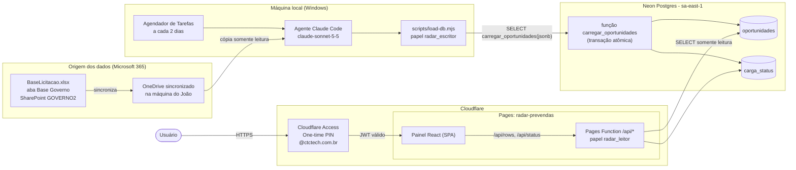
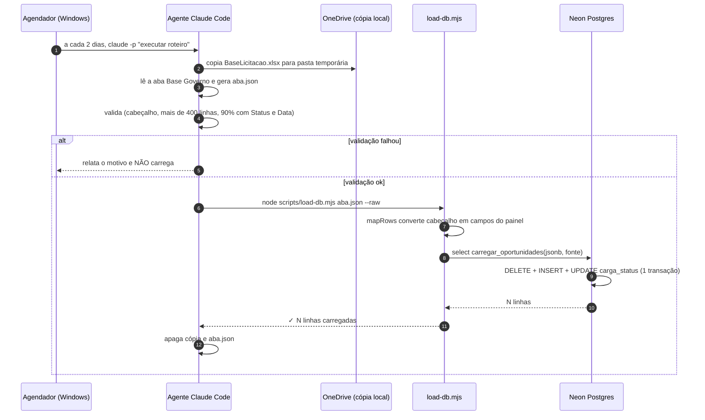
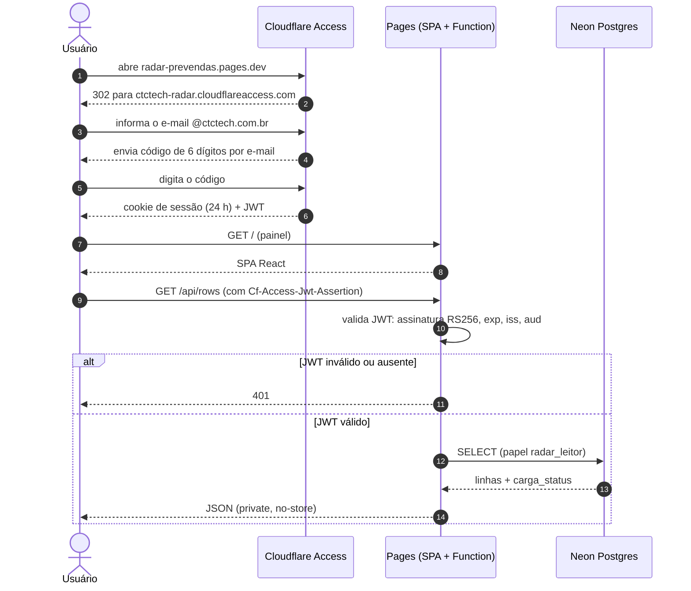
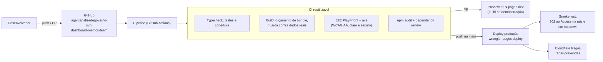
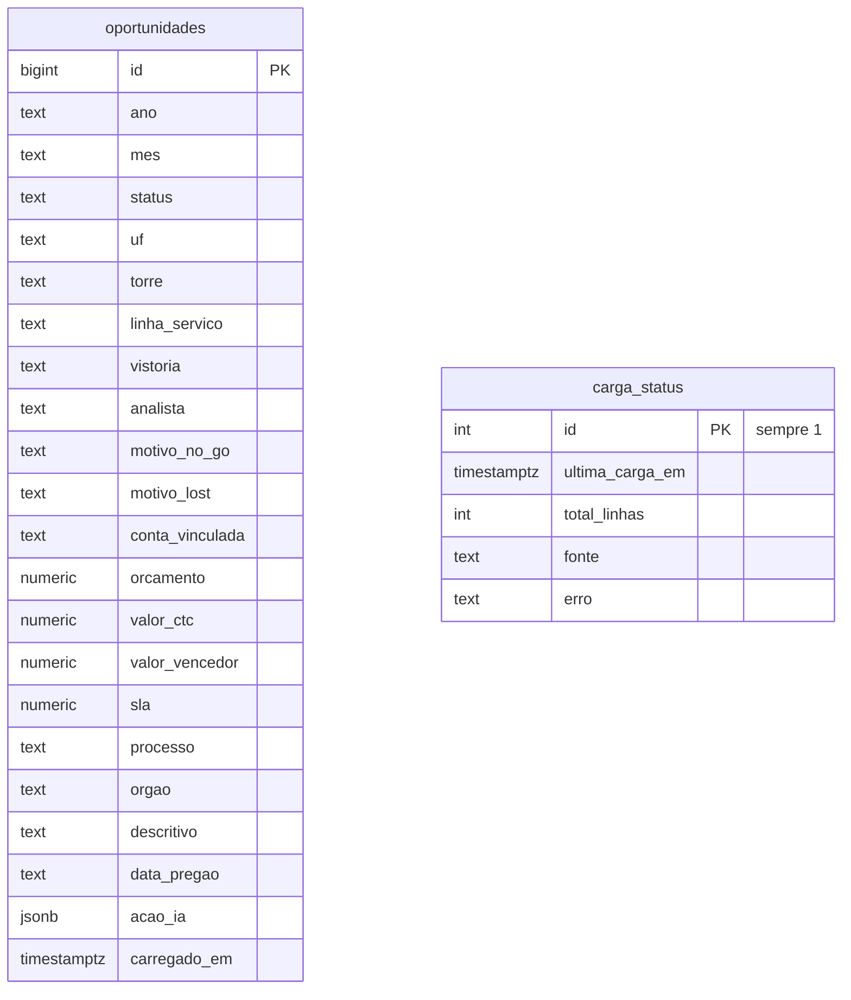

# Arquitetura do Radar Pré-Vendas

Painel interno de pré-vendas (licitações). Os dados nascem na planilha **BaseLicitacao.xlsx** (aba *Base Governo*), são copiados por um agente para um **Postgres (Neon)** e exibidos em um painel React protegido por **Cloudflare Access** (login por código enviado ao e-mail `@ctctech.com.br`).

Este documento cobre o caminho completo: planilha → agente → banco → API → painel → usuário. A operação do dia a dia está em [OPERACAO.md](OPERACAO.md).

## 1. Visão geral

**Ideia central:** dois caminhos totalmente separados e com privilégios mínimos. O agente só **escreve** (por uma única função) e o painel só **lê**. Nenhum dos dois consegue fazer o que o outro faz.

## 2. Carga de dados (planilha → banco)

Pontos de projeto:
- **Atomicidade:** a função troca a base inteira em uma transação. Se algo falhar, a base anterior permanece. Array vazio é recusado.
- **Somente leitura na origem:** o agente lê uma **cópia** da planilha e nunca grava nela.
- **Contrato único:** o cabeçalho da planilha é convertido nos campos do painel em `functions/_lib/rows.ts` (testado), reaproveitado por `load-db.mjs --raw`.
- **Rastreabilidade:** `carga_status` guarda a hora, o total de linhas, a fonte e o último erro de cada carga.

Roteiro completo do agente: [AGENTE-DE-CARGA.md](AGENTE-DE-CARGA.md). Contrato e esquema: [CARGA-DE-DADOS.md](CARGA-DE-DADOS.md) e [../db/schema.sql](../db/schema.sql).

## 3. Acesso do usuário (login → dados)

Camadas de proteção (defesa em profundidade):
1. **Borda:** a aplicação do Access barra quem não tem e-mail `@ctctech.com.br` antes de qualquer código rodar.
2. **API:** a Pages Function valida o JWT por conta própria, em **qualquer** endereço do projeto (inclusive `<hash>.radar-prevendas.pages.dev`, que a aplicação do Access não cobre). Sem `CF_ACCESS_*` configurado, devolve 503 (falha fechada).
3. **Banco:** a API usa `radar_leitor`, que só consegue `SELECT` em duas tabelas.
4. **Cabeçalhos:** CSP restritiva, `X-Frame-Options: DENY`, HSTS e `noindex` (`public/_headers`).

## 4. Entrega (código → produção)

- O build de **produção** não tem fallback para dados sintéticos: API fora do ar vira erro visível.
- `DEMO_MODE=true` (variável do GitHub) publica o build de demonstração com banner; está **desligado**.
- **Rollback:** *Actions → Pipeline → Run workflow* com `ref` = commit anterior.

## 5. Modelo de dados e privilégios

| Papel | Quem usa | Pode | Não pode |
|---|---|---|---|
| `radar_leitor` | API do painel (Pages Function) | `SELECT` em `oportunidades` e `carga_status` | escrever, apagar, executar a carga, criar objetos |
| `radar_escritor` | Agente de carga (`load-db.mjs`) | `EXECUTE carregar_oportunidades(jsonb, text)` | ler tabelas, apagar, alterar esquema |
| `neondb_owner` | Administração (console Neon / conector) | tudo | — (uso excepcional) |

A função `carregar_oportunidades` é `SECURITY DEFINER`: roda com os privilégios do dono, por isso o escritor não precisa de nenhum privilégio direto nas tabelas.

## 6. Inventário de componentes

| Componente | Onde | Identificação |
|---|---|---|
| Planilha | SharePoint GOVERNO2 (`connectcomcloud.sharepoint.com`) | `BaseLicitacao.xlsx`, aba *Base Governo* (~590 linhas, 33 colunas) |
| Agente de carga | máquina local do João | tarefa `RadarPreVendas-Carga`, modelo `claude-sonnet-5-5` |
| Banco | Neon, região `aws-sa-east-1` | projeto `radar-prevendas` (`young-breeze-09937213`), branch `main`, banco `neondb` |
| Hospedagem | Cloudflare Pages | projeto `radar-prevendas`, `https://radar-prevendas.pages.dev` |
| Autenticação | Cloudflare Zero Trust (plano Free) | time `ctctech-radar`, aplicação *Radar Pré-Vendas*, *One-time PIN*, política `@ctctech.com.br` |
| Código e CI/CD | GitHub | `agentanalisedegoverno-svg/dashboard-metrics-team` |

## 7. Decisões de arquitetura

| Decisão | Motivo | Alternativa descartada |
|---|---|---|
| Painel lê de um **banco**, não direto da planilha | Independe de permissões do Microsoft 365 (o TI demorava a responder) e deixa o painel rápido e estável | Leitura direta pelo Microsoft Graph (código no histórico; exigia app registration e consentimento de administrador) |
| **Agente** copia a planilha para o banco | Reaproveita o acesso que o João já tem ao OneDrive/M365; sem segredo de aplicativo | Função serverless com segredo do Graph |
| **Neon Postgres** | Gratuito, Postgres de verdade, driver HTTP que roda em Workers, região em São Paulo | Cloudflare D1 (exigiria permissões de token adicionais) |
| **Troca atômica** da base inteira | Simples, sem estados parciais, idempotente | Upsert por chave (a planilha não tem chave estável) |
| **Cloudflare Access** com código por e-mail | Sem TI e sem app registration; controle por domínio; plano gratuito | Login Microsoft (MSAL): código mantido no repositório, **desligado** |
| API valida o JWT **ela mesma** | A aplicação do Access cobre um hostname; a API também responde nos `<hash>.pages.dev` | Confiar só na borda |
| Papéis separados (leitor/escritor) e função `SECURITY DEFINER` | Privilégio mínimo: quem lê não escreve e vice-versa | Uma única conexão com poder total |

## 8. Limites e riscos conhecidos

- **Disponibilidade do agente:** depende da máquina do João ligada, com o OneDrive sincronizado. Se falhar, o painel continua com os dados da última carga (a data aparece em "Última atualização").
- **Troca total da base:** se o agente ler a planilha incompleta, apaga o resto. Mitigado pelas validações do roteiro (mínimo de linhas, cabeçalho, % de preenchimento).
- **Plano gratuito do Neon:** retenção de histórico de 6 horas para restauração; limites de computação. Suficiente para o volume atual (~590 linhas).
- **Dados sem Data Pregão** (2 linhas) ficam sem ano e mês e não entram nas métricas por ano.
- **SLA negativo** é descartado na carga (datas inconsistentes na planilha de origem).
- **Domínio completo no Access:** quem tem e-mail `@ctctech.com.br` entra, sem lista nominal. Para restringir, trocar a regra por e-mails específicos.
