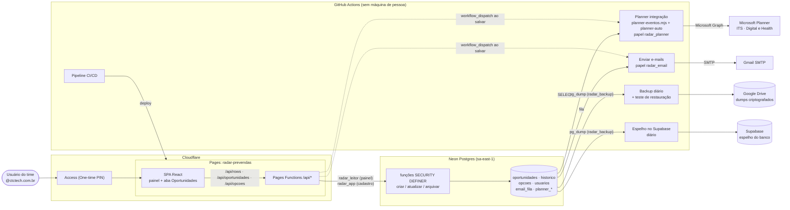
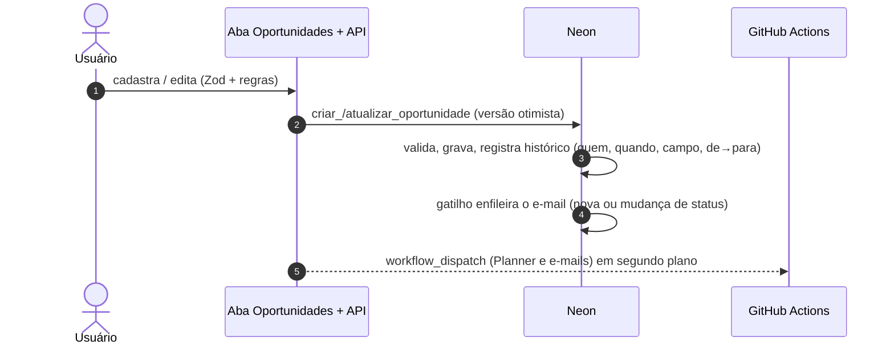
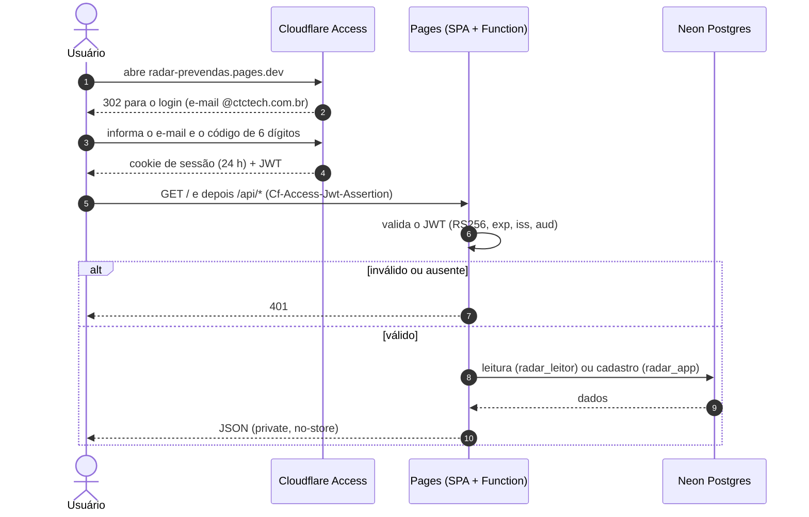
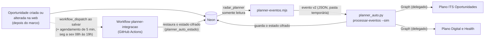
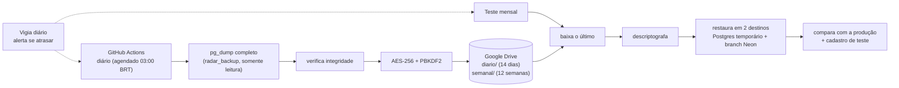
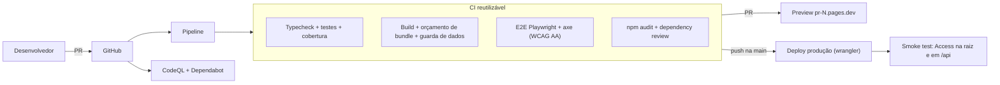
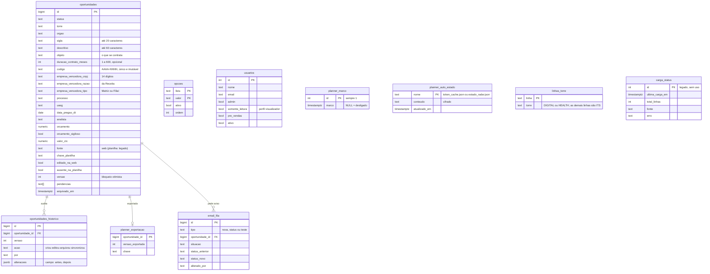

# Arquitetura do Radar Pré-Vendas

Painel interno de pré-vendas (licitações) **e** cadastro de oportunidades. O banco **Postgres (Neon)** é a fonte da verdade e é alimentado **só pelo Radar web** (desde 27/10/2026 a planilha *BaseLicitacao.xlsx* deixou de alimentá-lo: [decisão](DECISAO-FIM-DA-CARGA-DA-PLANILHA.md)). As rotinas (Planner, e-mail, backup, espelho) rodam na **nuvem do GitHub Actions**, acionadas pelo próprio Radar ao salvar, **sem depender de nenhum computador de pessoa**. Há um espelho diário do banco no Supabase.

A operação do dia a dia está em [OPERACAO.md](OPERACAO.md); o que vem a seguir está em [ROADMAP.md](ROADMAP.md).

> **Catálogo completo de diagramas** (contexto, contêineres, implantação, componentes, jornada, perfis, cadastro, carga, Planner, **e-mail**, backup, CI/CD, STRIDE, papéis do banco e ER), em camadas e atualizado: [DIAGRAMAS.md](DIAGRAMAS.md). Esta página traz a narrativa e as decisões.

## 1. Visão geral

**Ideia central:** cada componente tem um papel de banco com o **mínimo de privilégio** e só consegue o que precisa. Quem lê não escreve; quem exporta para o Planner só lê; quem faz backup só lê; quem cadastra só chama funções que validam e auditam.

## 2. Entrada de dados (só pelo Radar web)

> **Desde 27/10/2026 há uma só porta de entrada de dados: o cadastro no Radar web.** A carga da planilha por merge foi desativada e removida ([decisão](DECISAO-FIM-DA-CARGA-DA-PLANILHA.md)). O que está abaixo de "Legado" só existe como histórico no banco.

Regras de projeto:
- **Nada é apagado:** "excluir" na web é **arquivar** (só administrador, reversível).
- **Código da oportunidade** (`codigo`, `AAAA-NNNN`): identificador de negócio, único e imutável, numerado por ano da data do pregão. É o mesmo código mostrado no Radar e no título do cartão do Planner.
- **Legado da planilha (sem uso):** função `sincronizar_planilha`, tabela `carga_status`, colunas `chave_planilha` e `ausente_na_planilha`, e `fonte = 'planilha'` nas linhas antigas. A carga total antiga (`carregar_oportunidades`) segue bloqueada pelo banco.

Detalhes: [CADASTRO-OPORTUNIDADES.md](CADASTRO-OPORTUNIDADES.md). Histórico da carga (descontinuada): [AGENTE-DE-CARGA.md](AGENTE-DE-CARGA.md) e [CARGA-DE-DADOS.md](CARGA-DE-DADOS.md).

## 3. Cadastro pela web (API)

| Rota | Método | Quem | O que faz |
|---|---|---|---|
| `/api/rows`, `/api/status` | GET | qualquer usuário autenticado | dados do painel (papel `radar_leitor`) |
| (tela) **Administração** | — | só **administrador** | aba própria, em página inteira, com navegação lateral: *Usuários e perfis*, *Listas de opções* e *Linha → Torre* |
| `/api/me` | GET | autenticado | e-mail, nome, perfil (administrador, editor ou visualizador) |
| `/api/cnpj/:cnpj` | GET | autenticado | razão social e matriz/filial na Receita Federal, com 4 fontes públicas em sequência (BrasilAPI, minhareceita.org, publica.cnpj.ws, receitaws); não usa o banco |
| `/api/opcoes` | GET / PUT | todos leem; **admin** altera | listas fechadas e pré-vendas |
| `/api/usuarios` | PUT | **admin** | usuários, papéis e e-mails |
| `/api/email-config` | GET / PUT | **admin** | regras do e-mail de nova oportunidade: liga/desliga, status, destinatários, aviso ao pré-vendas ([EMAIL-NOVAS-OPORTUNIDADES.md](EMAIL-NOVAS-OPORTUNIDADES.md)) |
| `/api/email-config/teste` | POST | **admin** | enfileira um e-mail de teste só para o próprio administrador |
| `/api/oportunidades` | GET / POST | todos leem; **editor e admin** cadastram | grade e cadastro (aviso de duplicata) |
| `/api/oportunidades/:id` | GET / PUT | todos leem; **editor e admin** editam | leitura e edição com versão otimista (409 em conflito) |
| `/api/oportunidades/:id/historico` | GET | todos | trilha de alterações |
| `/api/oportunidades/:id/arquivar` · `/restaurar` | POST | **admin** | exclusão lógica reversível |

Camadas de proteção:
1. **Borda:** Cloudflare Access (domínio `@ctctech.com.br`).
2. **API:** valida o JWT do Access por conta própria (assinatura RS256, `exp`, `iss`, `aud`) em qualquer endereço do projeto; o **autor** vem do e-mail do JWT, nunca do corpo da requisição.
3. **CSRF:** escritas exigem o cabeçalho `x-radar-csrf` e `Origin` igual ao host.
4. **Formato:** esquema Zod compartilhado entre navegador e API (`src/domain/oportunidade.ts`), descartando campos desconhecidos.
5. **Regras de negócio no banco:** `validar_oportunidade` (obrigatórios, listas fechadas, Lost/No Go com motivo, Win com Valor CTC, datas, valores) — a **fonte da verdade** da validação; erros voltam campo a campo (HTTP 422).
6. **Torre e empresa vencedora:** a torre é recalculada no banco pela linha de serviço (tabela `linhas_torre`); razão social e matriz/filial são preenchidas pelo servidor com a consulta à Receita, ignorando o que vier do navegador.
7. **Banco:** a API usa `radar_app`, que só executa as funções de cadastro (não faz `INSERT` direto).
8. **Cabeçalhos:** CSP restritiva, `X-Frame-Options: DENY`, HSTS e `noindex`.

## 4. Acesso do usuário (login → dados)

## 5. Integração com o Microsoft Planner

- **Sentido único** (Radar → Planner). Só oportunidades **criadas na web depois da ativação** são enviadas (as linhas antigas da planilha nunca são).
- **Na nuvem, em tempo quase real:** o Radar aciona o workflow ao cadastrar ou salvar (cartão em cerca de 1 minuto); o agendamento de 5 minutos é só rede de segurança. O token do login Microsoft e as versões já aplicadas ficam **cifrados no banco** (`planner_auto_estado`). A tarefa do Windows foi **desativada em 28/10/2026**.
- **Torre → plano:** ITS vai para *ITS Oportunidades*; DIGITAL e HEALTH vão para *Digital e Health*.
- **Status → bucket e progresso**; **Pré-vendas → responsável** (e-mail cadastrado em *Administração → Usuários e perfis*); título `[AAAA-NNNN] Órgão | Objeto | PE | UASG | DATA` (o **código da oportunidade**).
- **Idempotente e conservador:** a chave (o código `AAAA-NNNN`) evita duplicar; versão antiga é ignorada; responsável vazio não mexe; nunca apaga cartão nem arquivo; erro vai para `erros\` com o motivo.

Contrato completo e mapeamentos: [INTEGRACAO-PLANNER.md](INTEGRACAO-PLANNER.md). **Regra de atualização** (o que o Radar sobrescreve, acrescenta e nunca toca no cartão, com cenários e exemplo): [INTEGRACAO-PLANNER.md#regra-de-atualização-o-que-acontece-no-cartão](INTEGRACAO-PLANNER.md#regra-de-atualização-o-que-acontece-no-cartão).

## 6. Backup e restauração

Runbook e restauração: [BACKUP.md](BACKUP.md).

## 7. Entrega (código → produção)

- Build de **produção** sem fallback sintético: API fora do ar vira erro visível.
- **Rollback:** *Actions → Pipeline → Run workflow* com `ref` = commit anterior.
- Dependabot não propõe *major* do `@tanstack/react-table` (a grade usa a v8).

## 8. Modelo de dados e privilégios

(A tabela `oportunidades` tem ~55 colunas: as 34 da planilha, as derivadas `ano`, `mes`, `sla`, e os metadados de auditoria. Esquema completo em [`db/migrations/`](../db/migrations/).)

| Papel | Quem usa | Pode | Não pode |
|---|---|---|---|
| `radar_leitor` | API do painel | `SELECT` nas tabelas de leitura | escrever, apagar |
| `radar_app` | API de cadastro | `SELECT` + `EXECUTE` das funções de cadastro | `INSERT` direto |
| `radar_escritor` | **Sem uso** (a carga da planilha foi descontinuada em 27/10/2026) | `EXECUTE sincronizar_planilha` (a carga total antiga foi revogada) | ler tabelas, apagar, alterar esquema |
| `radar_planner` | Exportador e `planner-auto` (GitHub Actions) | `SELECT` em oportunidades e usuários; grava só nas tabelas `planner_*` (inclui `planner_auto_estado`, cifrado) | alterar oportunidades |
| `radar_backup` | Backup diário e espelho no Supabase | leitura de tudo (`pg_read_all_data`) | gravar |
| `neondb_owner` | Administração (console/CLI) | tudo | — (uso excepcional) |

As funções de cadastro são `SECURITY DEFINER`: rodam com o privilégio do dono, então os papéis acima não precisam de acesso direto às tabelas para escrever.

## 9. Inventário de componentes

| Componente | Onde | Identificação |
|---|---|---|
| ~~Planilha~~ | SharePoint GOVERNO2 | `BaseLicitacao.xlsx`: **não alimenta mais o banco** desde 27/10/2026 |
| ~~Carga da planilha~~ | ~~máquina local do João~~ | **Desativada em 27/10/2026** (tarefa `Radar-Carga-Planilha` desativada; scripts removidos) |
| Integração Planner | GitHub Actions | workflow `planner-integracao.yml`: disparo ao salvar + agendamento de 5 min (seg–sex, 08h–19h); código em [`planner-auto/`](../planner-auto/). A tarefa do Windows `Radar-Planner integracao` está **desativada** (contingência) |
| E-mails | GitHub Actions | workflow `enviar-emails.yml`: disparo ao salvar + agendamento (nova oportunidade e mudança de status) |
| Banco | Neon, `aws-sa-east-1` | projeto `radar-prevendas`, branch `main`, banco `neondb` |
| Hospedagem | Cloudflare Pages | `https://radar-prevendas.pages.dev` |
| Autenticação | Cloudflare Zero Trust (Free) | time `ctctech-radar`, *One-time PIN*, política `@ctctech.com.br` |
| Código e CI/CD | GitHub | `agentanalisedegoverno-svg/dashboard-metrics-team` |
| Backup | GitHub Actions → Google Drive | `Backup do banco` (diário), `Teste de restauração do backup` (mensal, 2 destinos, inclui o branch Neon `teste-restauracao`) e `Vigia do backup` (alerta diário) |
| Espelho do banco | Supabase (plano Free, `us-east-1`) | projeto dedicado `radar-backup`; workflow `Backup no Supabase` (diário). Ver [BACKUP.md](BACKUP.md) |
| Planner | Microsoft 365 | planos *ITS Oportunidades* e *Digital e Health - Oportunidades* |

## 10. Decisões de arquitetura

| Decisão | Motivo | Alternativa descartada |
|---|---|---|
| Painel e cadastro leem/gravam num **banco** | Independe das permissões do Microsoft 365; rápido e estável; uma fonte da verdade | Leitura direta da planilha pelo Graph |
| **Fim da carga da planilha** (27/10/2026) | A migração para o Radar web terminou; a carga era paliativa e dependia de uma máquina | Manter a convivência planilha ↔ web ([decisão](DECISAO-FIM-DA-CARGA-DA-PLANILHA.md)) |
| **Rotinas no GitHub Actions disparadas pelo Radar** (28/10/2026) | Sem depender de computador de pessoa; tempo quase real; custo zero (repositório público); estado do Planner cifrado no banco | VM no GCP e cron no Render (exigem cartão e têm custo); tarefa do Windows (depende da máquina) |
| **Espelho diário no Supabase** | Segunda cópia viva do banco, além do backup criptografado no Drive | Só o backup em arquivo |
| **Neon Postgres** | Gratuito, Postgres de verdade, driver HTTP em Workers, região em São Paulo | Cloudflare D1 |
| **Regras de negócio no banco**, formato no Zod | Uma única fonte da verdade; vale para qualquer cliente (API, agente) | Validar só no navegador ou só na API |
| **Bloqueio otimista** (`versao`) + histórico por gatilho | Detecta edição simultânea; auditoria que não depende da aplicação | Última gravação vence |
| **Arquivar** em vez de excluir | Reversível e auditável | `DELETE` |
| **Cloudflare Access** com código por e-mail | Sem TI e sem app registration; plano gratuito | Login Microsoft (MSAL): código no repositório, **desligado** |
| API valida o JWT **ela mesma** | A borda cobre um hostname; a API responde também nos `<hash>.pages.dev` | Confiar só na borda |
| Papéis separados por função | Privilégio mínimo | Uma conexão com poder total |
| **Planner por eventos** (não chamada direta do Radar) | Nenhum segredo da Microsoft no Radar/Cloudflare; roda com o login delegado já aprovado pelo TI; o workflow roda na nuvem | Função serverless com permissão de aplicativo (pedido maior ao TI) |
| Backup por `pg_dump` criptografado | Restaura tudo (esquema, funções, gatilhos); cobre o histórico de 6 h do Neon free | JSON só dos dados |

## 11. Limites e riscos conhecidos

- **Login Microsoft do Planner:** é o de uma pessoa (delegado) e expira após ~90 dias sem uso; a renovação exige uma pessoa (`login` + `estado_db.py guardar`). Solução futura: app do Entra com permissão de aplicativo (precisa do administrador do tenant).
- **Agendamento do GitHub:** é "melhor esforço" e pode atrasar; o tempo real vem do disparo ao salvar (token `GITHUB_DISPATCH_TOKEN` no Cloudflare). Se o disparo falhar, o agendamento cobre.
- **Espelho no Supabase:** guarda só o estado mais recente e ainda não foi testado como banco ativo (faltam os papéis `radar_*`). O projeto gratuito pausa após 7 dias sem atividade; a restauração diária evita.
- **Planner:** sentido único; arquivar no Radar não atualiza o cartão; mudar a torre não move o cartão entre planos; o 50%/100% do Radar pode sobrescrever progresso marcado à mão.
- **Plano gratuito do Neon:** histórico de 6 h (coberto pelo backup diário); limites de computação, folgados para ~600 linhas.
- **Backup no Google Drive:** o token do rclone tem acesso à conta Google que o gerou; ver [BACKUP.md](BACKUP.md).
- **Domínio completo no Access:** quem tem e-mail `@ctctech.com.br` entra. Para restringir, trocar a regra por e-mails específicos.
- **Consulta de CNPJ:** depende de um serviço público (BrasilAPI, dados abertos da Receita). Se estiver fora do ar, o cadastro continua e a razão social é consultada de novo no próximo salvamento.
- **Nova linha de serviço:** o administrador pode criar a linha em *Administração → Listas de opções*, mas ela só vira DIGITAL/HEALTH se for incluída em `linhas_torre` (hoje por SQL); sem isso, resulta em ITS.
- **Perfis de acesso:** administrador (tudo), editor (cadastra e edita; padrão do domínio) e visualizador (só consulta, aplicado pelo e-mail). Só o administrador gerencia os grupos; o banco recusa cadastro/edição do visualizador e a remoção do último administrador.
- **Quem não está em `usuarios`** é tratado como editor (comportamento original). Para restringir de verdade o acesso ao Radar a uma lista nominal é preciso usar a política do Cloudflare Access.
