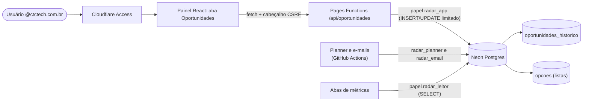

# Especificação: cadastro de oportunidades na aplicação web

> Status: **implementado e em produção** (F0–F5 concluídas: a planilha deixou de alimentar o banco em 27/10/2026, ver [DECISAO-FIM-DA-CARGA-DA-PLANILHA.md](DECISAO-FIM-DA-CARGA-DA-PLANILHA.md)). Este documento mantém a especificação original; o desenho atual está em [ARQUITETURA.md](ARQUITETURA.md) e o que falta em [ROADMAP.md](ROADMAP.md).
> Objetivo: tirar a planilha `BaseLicitacao.xlsx` do centro do processo. Os usuários da organização cadastram e atualizam oportunidades numa nova aba do Radar; cada gravação alimenta o banco que já serve as métricas do time.

## 1. Decisões de produto

| Tema | Decisão |
|---|---|
| Quem acessa | Qualquer usuário `@ctctech.com.br` (login pelo Cloudflare Access já existente). A identidade (e-mail) vai em todo registro e no histórico. |
| Cadastro | Qualquer usuário cadastra oportunidades. |
| Edição | Qualquer usuário edita; toda alteração fica no **histórico** (quem, quando, campo, valor anterior e novo). |
| Exclusão | Somente **administradores** arquivam (exclusão lógica, reversível). |
| Listas de opções | **Listas fechadas** (Status, Torre, Linha de Serviço, Pré-vendas, Site, Modalidade, motivos...), administráveis numa tela de configuração. Grafias normalizadas. |
| Virada da planilha | **Concluída em 27/10/2026**: a convivência acabou, o banco é alimentado só pelo Radar web e a carga da planilha foi removida (seção 3 fica como histórico). |
| Escopo da v1 | Formulário completo + grade com busca/filtros/ordenação + edição + histórico + migração limpa dos 600 registros atuais. |

## 2. Dicionário de dados (34 colunas da planilha)

Perfil feito sobre as 600 linhas de 14/10/2026. "Preench." é o percentual de linhas com valor.

| # | Coluna da planilha | Campo | Tipo | Preench. | Regra / observação |
|---|---|---|---|---|---|
| 1 | Data de distribuição (envio edital) | `data_distribuicao` | data | 90% | Opcional. Não pode ser posterior à Data Pregão (41 linhas violam hoje). |
| 2 | Status | `status` | lista | 98% | **Obrigatório**. 9 valores: No Go, Lost, Prospect, Canceled, On going, Win, Validar, Suspended, Go. "Validar" passa a ser *pendência*, não opção. |
| 3 | Data Pregão | `data_pregao` | data | 100% | **Obrigatória**. Deriva `ano` e `mes`. Faixa 2025-01 a 2026-12 hoje. |
| 4 | Instituição / Órgão | `orgao` | texto 1–120 | 100% | **Obrigatório**. 472 grafias distintas: autocompletar a partir de órgãos já cadastrados. |
| 5 | Descritivo | `descritivo` | texto ≤ 300 | 100% | **Obrigatório**. |
| 6 | Critério | `criterio` | lista | 90% | Menor Preço, Técnica e Preço (normalizar "preço/Preço"). |
| 7 | UF | `uf` | lista | 100% | 27 UFs. "Validar" e vazio viram pendência. |
| 8 | Processo | `processo` | texto ≤ 60 | 98% | Texto sempre (21 linhas vêm como número). Alerta de duplicata com órgão + data. |
| 9 | UASG | `uasg` | texto | 66% | Texto (preserva zero à esquerda; "-" vira vazio). |
| 10 | Modalidade | `modalidade` | lista | 98% | 14 valores; normalizar ("Chamamento"/"Chamamento Público"). |
| 11 | Tipo | `tipo` | lista | 0% | Quase não usada (2 linhas). **Saiu do formulário em 27/10/2026** (substituído por *Duração do contrato (meses)*); a coluna continua no banco e na carga, mas o salvamento não a altera. |
| 12 | Modo de Disputa | `modo_disputa` | lista | 89% | Aberto, Aberto e Fechado, Fechado, Dispensa com disputa. |
| 13 | Origem | `origem_oportunidade` | lista | 70% | Reativo, Proativo. |
| 14 | Pré-Vendas | `analista` | lista | 92% | 7 pessoas hoje. Lista administrável. |
| 15 | Site | `site` | lista | 82% | 25 grafias para ~12 portais reais. Lista normalizada. |
| 16 | Vistoria | `vistoria` | lista | 82% | Sim, Não, Opcional, Omissa (4 valores, sem variação de grafia). |
| 17 | Linha de Serviço | `linha_servico` | lista | 95% | 11 valores. |
| 18 | Torre | `torre` | lista | 100% | **Obrigatório**. ITS, DIGITAL, HEALTH. |
| 19 | Unidade de Fornecimento | `unidade_fornecimento` | texto | 1% | "Avançado". |
| 20 | Conta Vinculada | `conta_vinculada` | lista | 9% | Sim/Não (unifica "SIM"/"Sim"). |
| 21 | MC CTC | `mc_ctc` | número | 2% | Percentual. Hoje mistura 0,18 e 18: padronizar em fração (0–1) e validar faixa. |
| 22 | Simulação da MC x Arrematante | `simulacao_mc_arrematante` | número | 0% | Mesma regra de percentual. "Avançado". |
| — | Impostos (**campo novo, só no banco/web**) | `impostos` | percentual | — | Migração 008. Guardado como fração (0,0865 = 8,65%), faixa 0–100%, **duas casas decimais** no percentual (digitou 8,654, grava 8,65). Não vem da planilha: a carga por merge não o altera. Aparece em "Valores e margens", na grade e no histórico. |
| 23 | Orçamento | `orcamento` + `orcamento_sigiloso` | R$ ≥ 0 | 76% | "Sigiloso" (20 linhas) vira marcação própria, sem valor. |
| 24 | Valor Vencedor | `valor_vencedor` | R$ ≥ 0 | 28% | Aceita colar "R$ 7.500.000,00" e converte. Alerta se maior que o orçamento (2 linhas). |
| 25 | Valor CTC | `valor_ctc` | R$ ≥ 0 | 13% | **Obrigatório** quando Status = Win (hoje ok em 12/12). |
| 26 | Custo Total CTC | `custo_total_ctc` | R$ ≥ 0 | 0% | Coluna nova; "Avançado". |
| 27 | Motivo de NO GO | `motivo_no_go` | lista | 73% | **Obrigatório** quando Status = No Go (2 linhas violam hoje). 24 grafias → ~14 motivos. |
| 28 | Detalhe do NO GO | `detalhe_no_go` | texto longo ≤ 4000 | 68% | Multilinha (máx. 3.502 caracteres hoje). |
| 29 | Empresas Vencedoras | `empresas_vencedoras` | texto longo ≤ 500 | 32% | Idealmente lista de empresas; v1 texto. |
| 30 | Motivo do Lost | `motivo_lost` | lista | 5% | **Obrigatório** quando Status = Lost (30 linhas violam hoje). |
| 31 | Acompanhamento / Status / Observações | `observacoes` | texto longo ≤ 4000 | 11% | Multilinha. |
| 32 | Posição pós lance CTC | `posicao_lance` + `situacao_lance` | inteiro ≥ 1 + lista | 10% | "19ª posição" → 19; "Desclassificada" e "Não participamos" → `situacao_lance`. |
| 33 | Mês | *(derivado)* | — | 100% | Calculado de `data_pregao`. Não é digitado. |
| 34 | Ação IA | `acao_ia` | reservado | 0% | Pertence a outro agente. Aparece somente leitura; nunca editável no formulário. |

**Código da oportunidade** (`codigo`, `AAAA-NNNN`): identificador de negócio, atribuído automaticamente (ano da data do pregão + número sequencial do ano, de `0001` em diante), **único e imutável**. Aparece na grade, no formulário e no título do cartão do Planner. Numeração inicial feita em 21/10/2026 (da data do pregão mais antiga para a mais nova, por ano); depois disso, cada nova oportunidade recebe o próximo número do ano.

Campos derivados (nunca digitados): `ano`, `mes` (de `data_pregao`) e `sla` = dias entre `data_distribuicao` e `data_pregao`.

## 3. Convivência planilha ↔ web (sincronização por merge) — **histórico, encerrada em 27/10/2026**

> Esta seção descreve a convivência que existiu entre 20 e 27/10/2026. A carga foi **descontinuada e removida** ([decisão](DECISAO-FIM-DA-CARGA-DA-PLANILHA.md)).

O agente atual **apaga e reescreve toda a base**. Isso é incompatível com cadastro na web. Na convivência:

1. Cada linha tem `fonte` (`planilha` ou `web`) e `chave_planilha` (identificador estável gerado a partir de processo + órgão + data pregão + torre, com contador para repetições).
2. O agente deixa de usar `carregar_oportunidades` (substituição total) e passa a chamar `sincronizar_planilha`, que: **insere** linhas novas, **atualiza** linhas da planilha que mudaram e **nunca toca** em linhas de origem `web` nem em linhas **editadas na web** (campo `editado_na_web`).
3. Linha que sumiu da planilha **não é apagada**: é marcada `ausente_na_planilha` e aparece para revisão.
4. No cadastro web, o sistema avisa de **possível duplicata** (mesmo processo + órgão + data) antes de salvar.
5. Regra de ouro: **a edição na web vence a planilha**. Definir a data de encerramento da convivência para o time parar de editar o Excel.

## 4. Validações

**Bloqueiam o salvamento** (erro): Status, Data Pregão, Órgão, Descritivo e Torre obrigatórios; valores monetários ≥ 0; datas válidas; Data Pregão ≥ Data de distribuição; opções só das listas; Motivo de NO GO obrigatório se No Go; Motivo do Lost obrigatório se Lost; Valor CTC obrigatório se Win; limites de tamanho.

**Avisam mas permitem** (alerta): possível duplicata; Valor Vencedor > Orçamento; Valor CTC > Orçamento; pregão no passado com status Prospect/On going; UF fora da lista (pendência); campos em "Validar" (vão para a visão **Pendências**).

As mesmas regras rodam **no navegador e na API** (um único esquema Zod compartilhado), e a API é a fonte de verdade.

## 5. Arquitetura

- **Banco:** colunas novas na tabela `oportunidades` (apenas adições, sem quebrar o painel atual); tabelas `opcoes` (listas), `oportunidades_historico` (auditoria) e `usuarios_admin`.
- **API:** `GET/POST /api/oportunidades`, `GET/PATCH /api/oportunidades/:id`, `POST /api/oportunidades/:id/arquivar` (admin), `GET /api/opcoes`, `GET /api/oportunidades/:id/historico`. Validação Zod, **bloqueio otimista** (`versao`: se dois usuários editam a mesma linha, o segundo recebe conflito em vez de sobrescrever), e papel de banco **dedicado** com permissão só para o necessário.
- **Segurança:** identidade vem do JWT do Access (nunca do corpo da requisição); proteção CSRF (cabeçalho obrigatório + verificação de origem); consultas parametrizadas; limites de tamanho; trilha de auditoria imutável.

## 6. Experiência de uso e responsividade (celular até 4K/8K)

- **Aba "Oportunidades"** com duas visões: **Grade** (consulta) e **Formulário** (cadastro/edição em painel lateral ou página).
- **Formulário em seções** (nada de 34 campos numa tela só): *Identificação* (órgão, processo, UASG, descritivo, datas), *Edital* (modalidade, critério, modo de disputa, site, vistoria, UF), *Equipe* (torre, linha, pré-vendas, origem), *Resultado* (status, motivos, valores, posição, vencedores), *Avançado* (campos raros). Campos condicionais aparecem conforme o Status. Resumo fixo com pendências e alertas.
- **Grade:** busca global, filtros por Status/Torre/Linha/Pré-vendas/período, ordenação, colunas configuráveis, **virtualização** (fluida com milhares de linhas), edição rápida em painel, indicador de pendências.
- **Responsivo de 320 px a 8K:** layout em *grid* fluido com `minmax` e consultas de contêiner; largura máxima de leitura controlada e tipografia fluida (`clamp`); em telas muito largas a grade ganha colunas e o formulário vira duas ou três colunas, em vez de esticar campos; alvos de toque ≥ 44 px no celular; tema claro/escuro; testes visuais em 390, 768, 1280, 1920, 3840 e 7680 px.
- **Acessibilidade WCAG 2.2 AA:** rótulos e erros associados aos campos, foco visível e navegação por teclado, contraste verificado (já temos teste automático com axe).

## 6.1 Ajustes pós-lançamento (22/10/2026)

| Ajuste | Como ficou |
|---|---|
| **Tela cheia, travada** | Clicar numa oportunidade abre em **tela cheia** com todos os campos **travados** (leitura). O botão **Editar** fica no topo; ao clicar, os campos liberam e aparecem **Cancelar** e **Salvar alterações** embaixo. Cancelar com alterações pede confirmação; depois de salvar, a tela volta ao modo leitura com os dados novos. Oportunidade nova abre direto em edição. |
| **Descritivo** | Sem limite de caracteres. |
| **Documentação: nome e link da pasta** (novo, 29/10/2026) | Dois campos opcionais, **em amarelo**, na seção *Documentação* (migração 023, colunas `documentos_nome` e `documentos_url`). O link só aceita `https://`; quem informa o nome precisa informar o link. No formulário aparece o botão *Abrir pasta*; vai também na anotação do Planner e no e-mail. A API externa aceita os dois campos. Não existem na planilha. |
| **Duração do contrato (meses)** (novo, 27/10/2026) | Número inteiro de **1 a 600**, opcional, **em amarelo**, no lugar do antigo campo *Tipo* (migração 019, coluna `duracao_contrato_meses`). Não existe na planilha. Aparece na anotação do Planner e no e-mail, na seção *Edital e disputa*. |
| **Campos em reais** (27/10/2026) | **Orçamento, Valor CTC, Custo total CTC e Valor vencedor** usam máscara de **real brasileiro**: ao digitar, só os números contam e os dois últimos são os centavos (`123456` vira `R$ 1.234,56`). Ao salvar, o valor volta a número. Na grade, no Planner e no e-mail já apareciam em reais. |
| **API externa** (28/10/2026) | Outra aplicação pode criar oportunidades com **os mesmos campos e regras** deste formulário (`POST /api/externo/oportunidades`), com autoria `api:<aplicação>` e o campo opcional `solicitante`. **Ao criar, renomear ou remover um campo, atualize [API-EXTERNA.md](API-EXTERNA.md)** (um teste falha se faltar) e avise quem usa a API. |
| **Sigla** (novo, 26/10/2026) | Texto de **até 20 caracteres**, opcional, logo **antes de Instituição / Órgão** (migração 015; limite ampliado de 8 para 20 na 017). **Não existe na planilha**: fica em branco nos registros importados e a carga não o toca. Aparece como coluna na grade e entra na busca. |
| **Objeto** (novo, 26/10/2026) | Campo de texto (até 5.000 caracteres) **logo abaixo do Descritivo**: o que está sendo contratado. **Não existe na planilha**: fica em branco nos registros importados e a carga diária não o toca. Quando preenchido, é o que aparece no título do cartão do Planner e no e-mail (em branco, o título usa o descritivo, como sempre). |
| **Hora do pregão** (novo, 26/10/2026) | Campo opcional **ao lado da Data do pregão**, em horário de Brasília (`hora_pregao`). A data continua sendo a data (código por ano, SLA, painel e planilha não mudam); a hora é um complemento. **Não existe na planilha**: fica em branco nos registros importados e a carga não a toca. A grade mostra `dd/mm/aaaa hh:mm` quando há hora e só a data quando não há; o título do cartão do Planner, o prazo (com a hora) e o e-mail também a usam. |
| **Logo** | Logo da CTC no cabeçalho (branco, dentro de faixa azul-marinho para funcionar nos temas claro e escuro). |
| **Status na grade** | Bolinhas: **Win** verde · **Go** azul · **No Go** laranja · **On going** amarela · **Lost** vermelha · demais cinza. |
| **Linha de serviço antes da Torre** | A ordem foi invertida. A **Torre é calculada** pela linha (mesma regra da planilha): *Software Development*, *Key Talent* (e as antigas *Aplication Development*, *Business Automation*, *Soluções Digitais*) → **DIGITAL**; *Lya Gov*, *AutoAtendimento Gov*, *Fastcomm Gov* → **HEALTH**; qualquer outra → **ITS**. Com a linha preenchida a torre fica travada; sem linha, escolhe-se à mão. O banco garante a regra (gatilho), qualquer que seja o caminho de gravação. |
| **Unidade de fornecimento** | Lista fechada (combo): **Posto de Trabalho, Serviço (valor fixo), UST** (migração 014, 26/10/2026). "Serviço" virou "Serviço (valor fixo)" (opção e registros; a carga da planilha converte sozinha); Ponto de Função e Hora ficaram inativos (nenhum registro os usava). |
| **Pré-vendas** (vários) | Uma oportunidade aceita **mais de um** pré-vendas (migração 014, 26/10/2026): no formulário são caixas de marcar; no banco ficam no mesmo campo, separados por vírgula (`Ana, Marcia`). Cada nome precisa estar na lista de pré-vendas ativos. O filtro da grade acha a oportunidade por qualquer um deles, o e-mail de aviso e o responsável do cartão do Planner valem para todos, e o painel de concentração conta a oportunidade para cada pré-vendas. |
| **Empresa vencedora (CNPJ)** | Digita-se **só o CNPJ** (com máscara e validação dos dígitos). O Radar consulta a **Receita Federal** (dados abertos, via BrasilAPI, pelo servidor) e mostra a **razão social** e se é **Matriz** ou **Filial**. A consulta é refeita no salvamento e o navegador nunca é a fonte desses dados. Receita fora do ar: salva só o CNPJ e avisa (mantém a razão já gravada se o CNPJ não mudou). O texto antigo de "Empresas vencedoras" (238 registros) fica visível como *registro anterior* e não é apagado. |

### Perfis de acesso (alçada)

| Perfil | Quem é | Pode |
|---|---|---|
| **Administrador** | marcado como *Administrador* na aba *Administração* (hoje: João Henrique, Flávio Santanna e Jefferson Oliveira) | tudo: ver, cadastrar, editar, **arquivar/restaurar**, administrar listas e **perfis de usuários** |
| **Editor** | **padrão** de todo `@ctctech.com.br` que não esteja marcado como visualizador (comportamento que já existia) | ver, cadastrar e editar; **não** arquiva nem administra |
| **Visualizador** | marcado como *Visualizador* (precisa do e-mail) | **só consulta**: grade, filtros, tela de leitura e histórico; não vê botões de cadastrar, editar ou arquivar |

Regras: **só o administrador** cria ou remove alguém dos grupos (a aba *Administração* e a função do banco `salvar_usuario` são exclusivas de administrador). Administrador e visualizador são **excludentes**. O sistema **nunca fica sem administrador** (o banco recusa rebaixar ou desativar o último). Remover alguém do grupo visualizador = desmarcar a caixa, e a pessoa volta a ser editor. A restrição é aplicada **no banco** (cadastro e edição recusam o visualizador com 403), não só escondida na tela.

## 7. Bibliotecas

Mantemos a base atual (React 19, TypeScript, Tailwind v4, componentes no padrão shadcn/ui sobre Radix) e adicionamos só o necessário:

| Necessidade | Biblioteca | Motivo |
|---|---|---|
| Formulário | **React Hook Form** + resolver **Zod** | Pouco re-render, validação por esquema compartilhado com a API. |
| Grade | **TanStack Table** + **TanStack Virtual** | Padrão de mercado, headless (combina com Tailwind), virtualização. |
| Dados/cache | **TanStack Query** (já usado) | Mutations com atualização otimista e invalidação. |
| Campos | componentes shadcn (Select, Combobox/Command, Popover, Calendar, Sheet, Tabs) | Acessíveis e consistentes com o painel atual. |
| Datas | **date-fns** (pt-BR) | Leve e sem estado global. |
| Notificações | **sonner** | Toasts acessíveis. |

## 8. Plano em fases (estado)

| Fase | Entrega | Critério de aceite |
|---|---|---|
| F0 ✅ | Esta especificação revisada | Aprovada pelo dono do produto. |
| F1 ✅ | **Banco:** migração aditiva, listas normalizadas, histórico, papel `radar_app`, `sincronizar_planilha`; backfill dos 600 registros com relatório de qualidade | Painel atual segue idêntico; 600 linhas migradas; relatório de pendências gerado. |
| F2 ✅ | **API** com validação, auditoria, bloqueio otimista, CSRF e papéis | Testes unitários e de contrato; conflito de edição detectado. |
| F3 ✅ | **Front:** aba Oportunidades (formulário, grade, edição, histórico) | E2E (criar, editar, conflito, arquivar), axe sem violações, visual 390–7680 px. |
| F4 ✅ | **Convivência:** agente passa ao merge; runbook e data de encerramento | Carga do agente não sobrescreve edição web (teste automatizado). |
| F5 ✅ | Encerramento: a carga foi desativada e removida (27/10/2026) | [Decisão](DECISAO-FIM-DA-CARGA-DA-PLANILHA.md). |

## 9. Riscos e pontos em aberto (resolvidos e pendentes)

- **Quem são os administradores** (e-mails): preciso da lista para o papel de arquivar e editar listas.
- **Lista de Pré-vendas:** são pessoas do time, não necessariamente usuários do Access; manter lista própria ou mapear para e-mail?
- **Dados com problema** (41 pregões antes da distribuição, 30 Lost sem motivo, 6 grupos duplicados): corrigir na migração (com revisão do time) ou migrar como pendência?
- **Duplo lançamento** durante a convivência: mitigado pelo alerta de duplicata, mas depende de disciplina; por isso a data de encerramento.
- **Custo Total CTC e Ação IA:** campos novos/reservados; confirmar se `Ação IA` continuará sob outro agente.

**Resolvido:** administradores (`joao.henrique@ctctech.com.br`; os demais são promovidos na própria aba); Pré-vendas viram usuários com e-mail (também usado para atribuir cartões no Planner); dados com problema migraram como **pendência**; permissões mantidas (todos cadastram e editam, só o admin arquiva).
**Pendente:** destino de `Ação IA`.
