# Diagramas do Radar Pré-Vendas

| | |
|---|---|
| **Propósito** | Catálogo visual de todos os fluxos da aplicação, do contexto ao detalhe, para quem desenvolve, opera, audita ou aprova mudanças |
| **Versão / atualização** | 1.3 · 28/10/2026 · cobre as migrações 001 a 020 |
| **Fonte** | Mermaid, neste arquivo (o GitHub desenha sozinho). Todo diagrama foi validado no conector do Mermaid antes de entrar. Versões em SVG em [diagramas/](diagramas/), geradas por `npm run diagramas` |
| **Padrão adotado** | Guia *Architecture design diagrams* da Microsoft (Well-Architected): camadas **contexto → contêiner → componente**, mais implantação, fluxo de dados com fronteiras de confiança (STRIDE), sequência por caso de uso, jornada do usuário, estado, ER e fluxo de identidade; vocabulário do **C4** (contexto/contêiner/componente) e do **UML** (sequência/estado) |
| **Relacionados** | [ARQUITETURA.md](ARQUITETURA.md) (decisões e narrativa), [OPERACAO.md](OPERACAO.md), [TESTES.md](TESTES.md) |

## Como ler

Convenções iguais em **todos** os diagramas (consistência é parte do padrão):

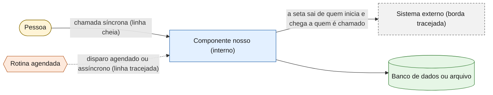

- **Forma + texto, não só cor:** pessoa = estádio, banco/arquivo = cilindro, rotina agendada = hexágono, externo = borda tracejada. A cor reforça, nunca é a única pista.
- **Setas** vão do iniciador para a dependência; a resposta, quando importa, aparece como seta separada.
- **Rótulo de papel de banco** (`radar_app`, `radar_leitor`…) indica com qual credencial o componente fala com o banco.

## Índice

| Camada | Diagramas |
|---|---|
| **Visão geral** | [D1 Contexto](#d1--contexto-c4-nível-1) · [D2 Contêineres](#d2--contêineres-c4-nível-2) · [D3 Implantação](#d3--implantação-onde-cada-coisa-roda) · [D4 Componentes](#d4--componentes-c4-nível-3) |
| **Usuário e acesso** | [D5 Jornada do usuário](#d5--jornada-do-usuário) · [D6 Perfis e permissões](#d6--perfis-e-permissões-identidade-e-acesso) |
| **Cadastro** | [D7 Cadastro](#d7--cadastro-de-oportunidade) · [D8 Edição concorrente](#d8--edição-concorrente-versão-otimista) · [D9 Regras de validação](#d9--regras-de-validação) · [D10 Estados](#d10--ciclo-de-vida-estados) · [D11 Consulta de CNPJ](#d11--consulta-de-cnpj) |
| **Integrações** | [D12 Carga da planilha (descontinuada)](#d12--carga-da-planilha-descontinuada) · [D13 Planner](#d13--integração-com-o-microsoft-planner) · [D14 E-mail](#d14--e-mail-de-nova-oportunidade) |
| **Confiabilidade** | [D15 Backup e resiliência](#d15--backup-restauração-e-resiliência) · [D16 CI/CD e testes](#d16--entrega-e-testes-cicd) |
| **Segurança e dados** | [D17 Fluxo de dados e STRIDE](#d17--fluxo-de-dados-e-fronteiras-de-confiança-stride) · [D18 Papéis do banco](#d18--papéis-do-banco-e-privilégios) · [D19 Modelo de dados](#d19--modelo-de-dados-er) |

---

## Visão geral

### D1 · Contexto (C4 nível 1)

*Tipo: contexto · Escopo: o sistema como caixa-preta, com quem fala · Pergunta que responde: **quem usa e do que depende?***

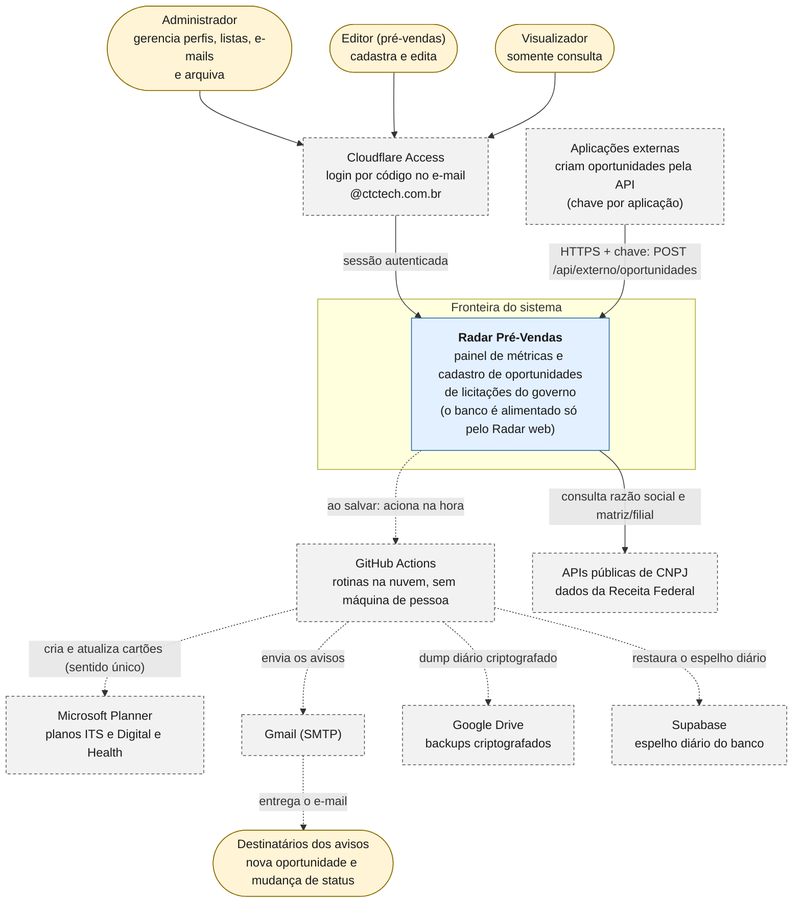

### D2 · Contêineres (C4 nível 2)

*Tipo: contêiner · Escopo: as peças executáveis, tecnologia e protocolo · Pergunta: **do que o sistema é feito e como as peças conversam?***

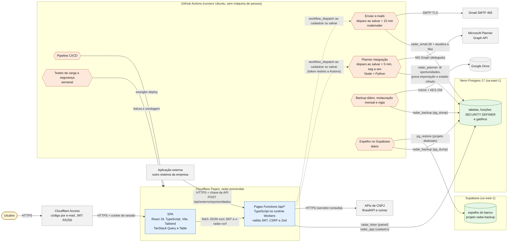

### D3 · Implantação (onde cada coisa roda)

*Tipo: implantação · Escopo: infraestrutura, agendas e ambientes · Pergunta: **onde roda, quando e em que ambiente?***

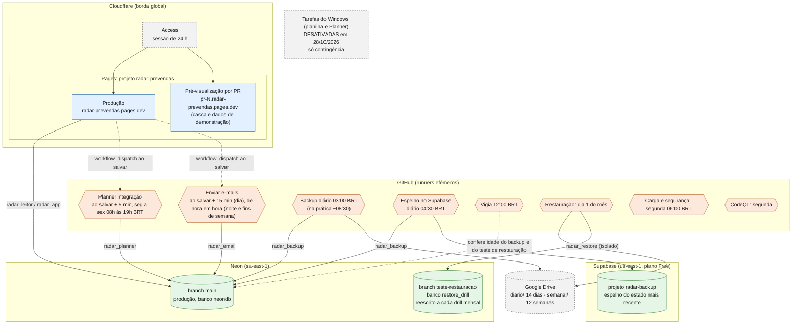

### D4 · Componentes (C4 nível 3)

*Tipo: componente · Escopo: módulos do código e como se ligam · Pergunta: **em que arquivo mora cada responsabilidade?***

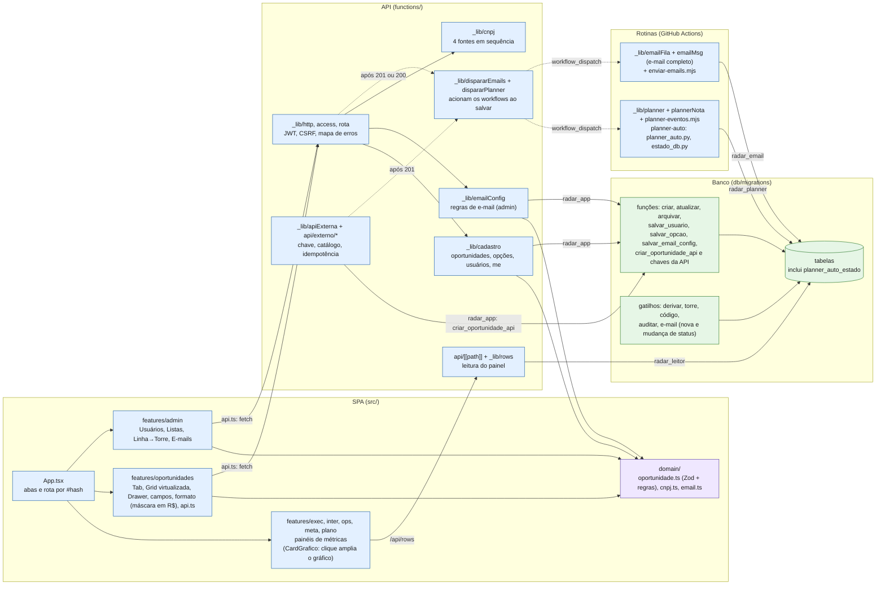

---

## Usuário e acesso

### D5 · Jornada do usuário

*Tipo: fluxo de usuário · Escopo: do login às telas, por perfil · Pergunta: **o que cada pessoa consegue fazer e por onde?***

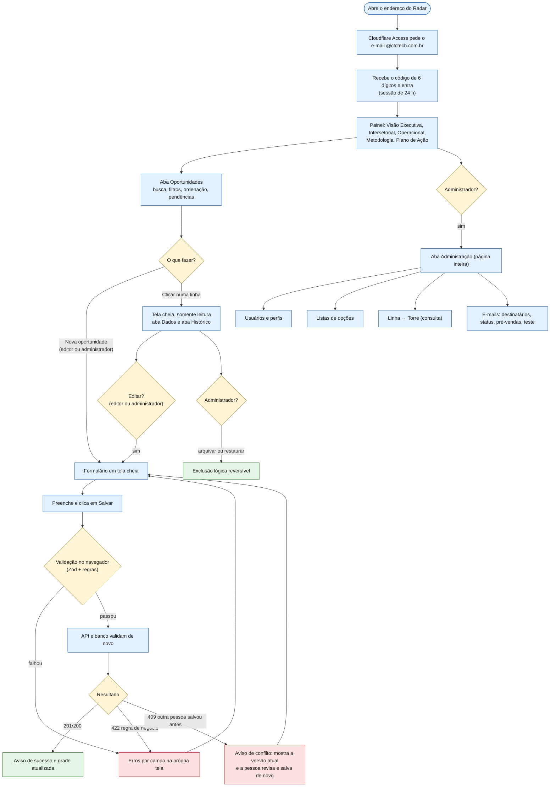

### D6 · Perfis e permissões (identidade e acesso)

*Tipo: fluxo de identidade e acesso · Escopo: como o perfil é decidido e onde é imposto · Pergunta: **quem pode o quê, e quem garante?***

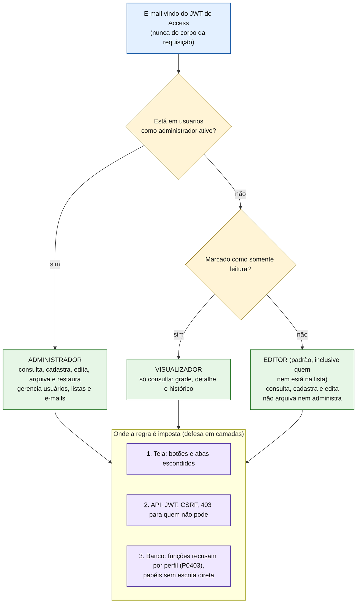

Regras que o desenho resume: o administrador **não** pode ser somente leitura; o sistema **nunca** fica sem administrador ativo; a pessoa **não** rebaixa nem desativa a si mesma; só administrador cria ou remove alguém dos grupos.

---

## Cadastro

### D7 · Cadastro de oportunidade

*Tipo: sequência · Caso de uso: usuário cadastra uma oportunidade · Pergunta: **o que acontece, em ordem, do clique ao registro?***

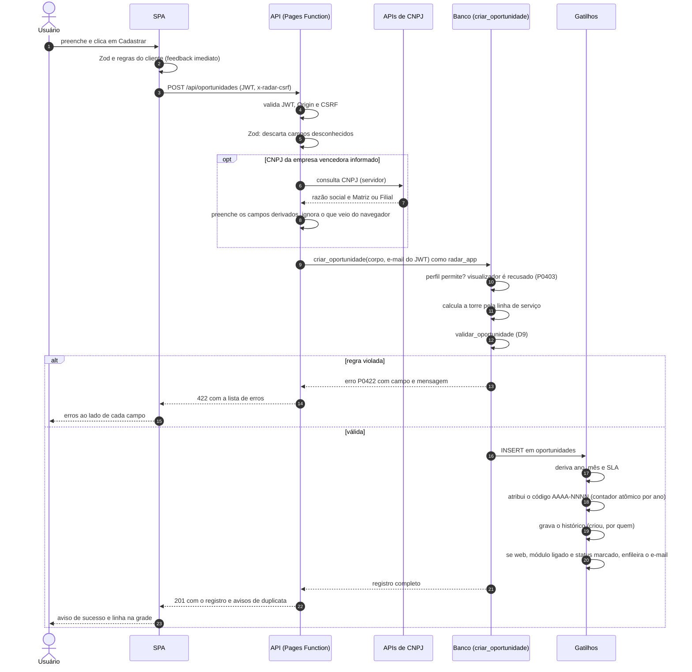

### D8 · Edição concorrente (versão otimista)

*Tipo: sequência · Caso de uso: duas pessoas editam a mesma oportunidade · Pergunta: **como evitar que uma sobrescreva a outra sem perceber?***

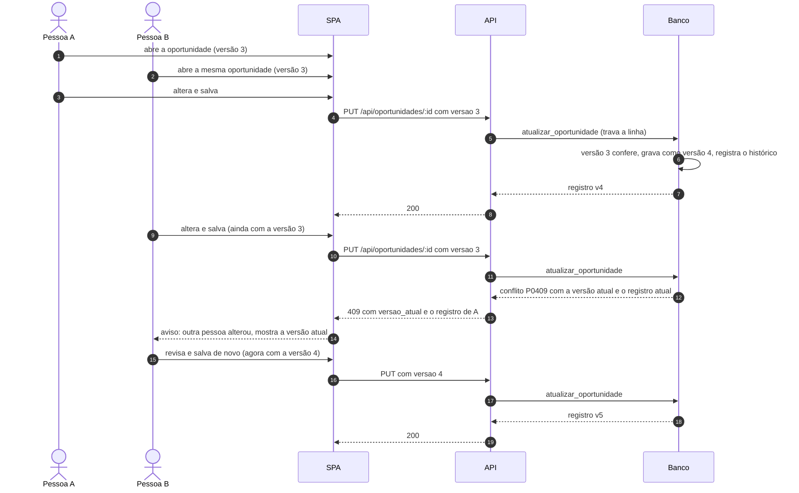

### D9 · Regras de validação

*Tipo: fluxograma de decisão · Escopo: tudo que `validar_oportunidade` confere, na ordem · Pergunta: **por que o sistema recusou?***

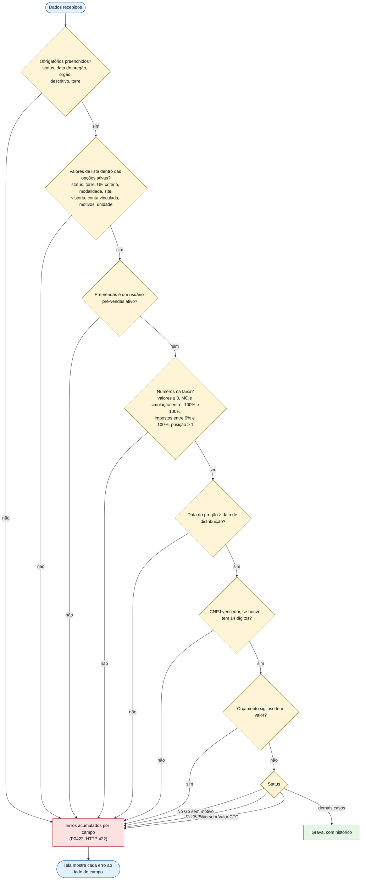

*Os erros são **acumulados**: o usuário vê todos de uma vez. A tela repete as regras principais só para feedback imediato; a fonte da verdade é o banco.*

### D10 · Ciclo de vida (estados)

*Tipo: estado (registro) e fluxograma (status) · Escopo: o ciclo de vida do registro e as exigências de cada status · Pergunta: **em que estados uma oportunidade pode estar, o que muda isso e o que cada status exige?***

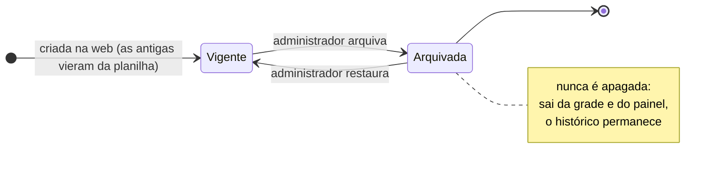

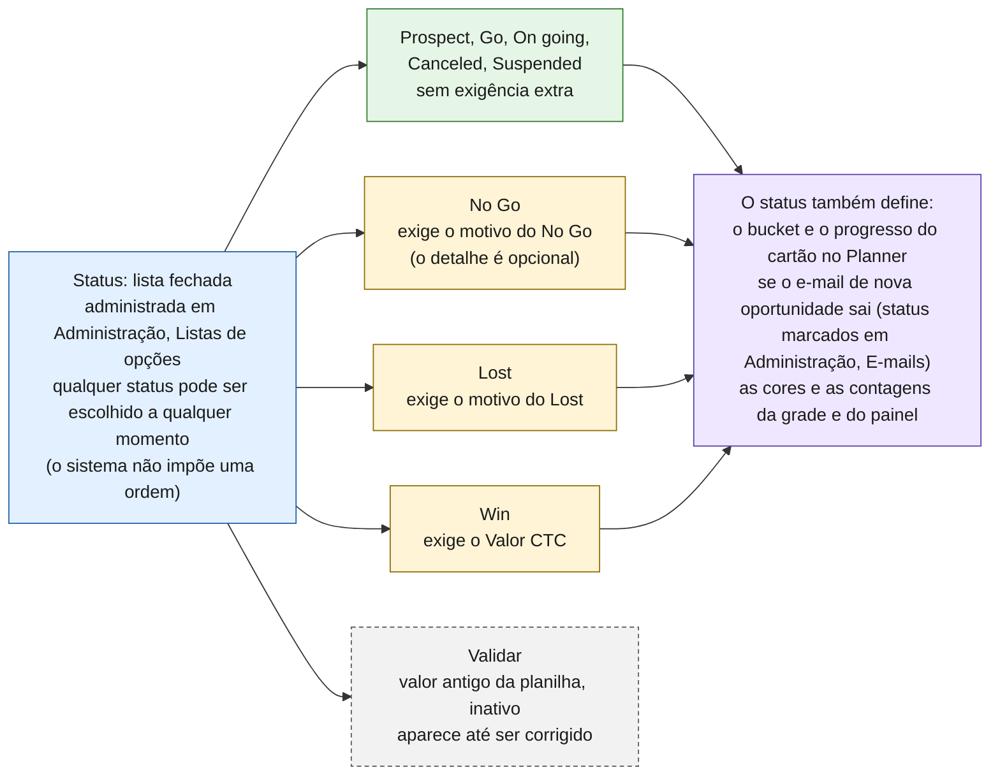

### D11 · Consulta de CNPJ

*Tipo: fluxograma · Escopo: preenchimento de razão social e matriz/filial · Pergunta: **como o servidor decide o resultado entre fontes instáveis?***

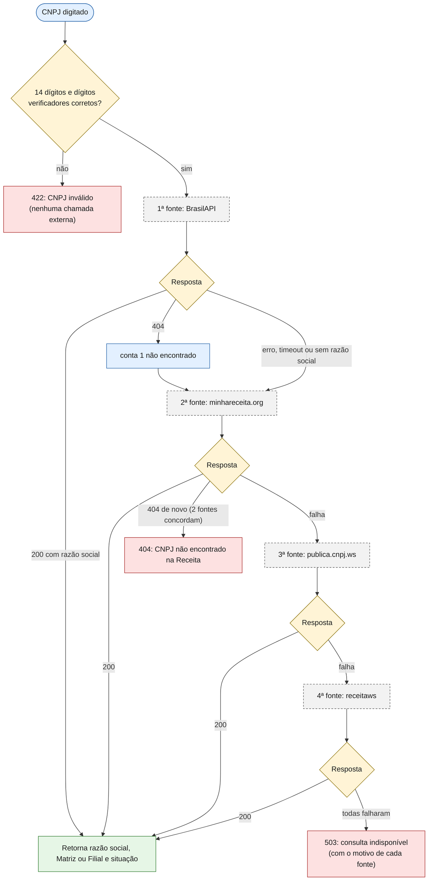

*Duas respostas 404 (de quaisquer duas fontes) encerram como "não encontrado". Cada fonte tem tempo limite de 5 s. A tela nunca chama a Receita: a CSP só permite o próprio site, e o servidor faz a consulta. Se o CNPJ for apagado, razão social e tipo são zerados no banco.*

---

## Integrações

### D12 · Carga da planilha (descontinuada)

*Tipo: fluxo (histórico) · Escopo: o fim da carga da planilha · Pergunta: **a planilha ainda alimenta o banco?** Não: desde 27/10/2026 o Radar web é a única porta de entrada ([decisão](DECISAO-FIM-DA-CARGA-DA-PLANILHA.md)).*

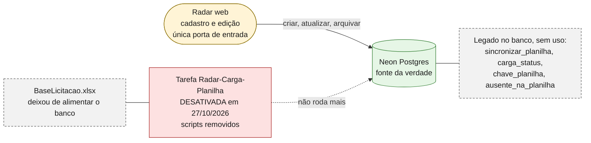

### D13 · Integração com o Microsoft Planner

*Tipo: sequência · Caso de uso: oportunidade da web vira cartão · Pergunta: **como o cartão nasce e se atualiza, sem duplicar?***

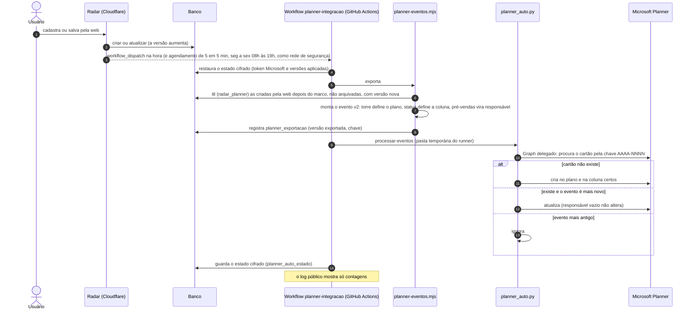

*Sentido único (Radar → Planner). Nunca apaga cartão nem arquivo. As oportunidades vindas da planilha nunca são enviadas. **O que muda em cada campo do cartão a cada salvamento** (e o desenho da decisão) está em [INTEGRACAO-PLANNER.md](INTEGRACAO-PLANNER.md#regra-de-atualização-o-que-acontece-no-cartão).*

### D14 · E-mail de nova oportunidade

*Tipo: sequência + decisão · Caso de uso: aviso por e-mail ao cadastrar · Pergunta: **quando o e-mail sai, para quem, e o que acontece se falhar?***

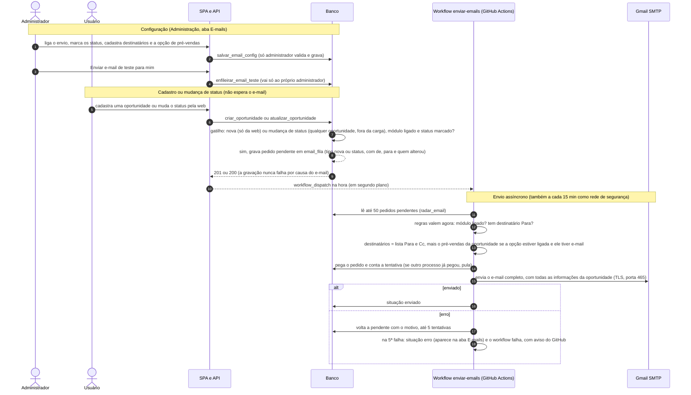

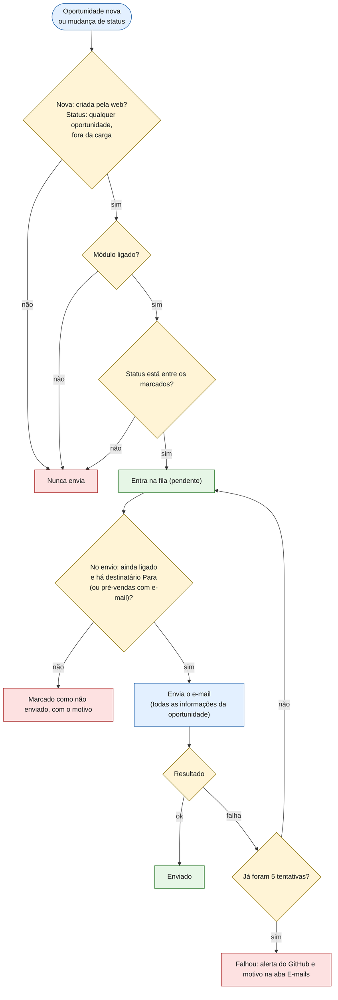

---

## Confiabilidade

### D15 · Backup, restauração e resiliência

*Tipo: mapa de disponibilidade e resiliência · Escopo: proteção dos dados e metas · Pergunta: **quanto dado posso perder e como sei que o backup funciona?***

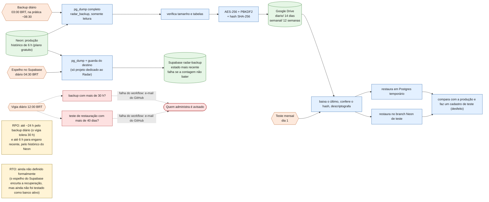

### D16 · Entrega e testes (CI/CD)

*Tipo: fluxograma · Escopo: do código à produção e as rotinas de teste · Pergunta: **o que impede um erro de chegar à produção?***

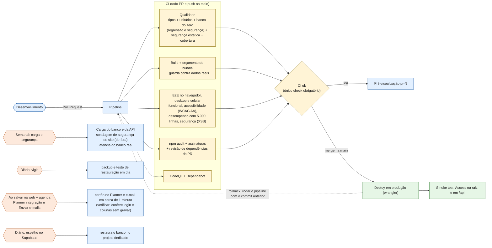

---

## Segurança e dados

### D17 · Fluxo de dados e fronteiras de confiança (STRIDE)

*Tipo: fluxo de dados com fronteiras de confiança (DFD de modelagem de ameaças) · Pergunta: **por onde os dados passam, onde a confiança muda e o que protege cada travessia?***

```mermaid
flowchart LR
  classDef pessoa fill:#fff4d6,stroke:#8a6d00,color:#1a1a1a
  classDef proc fill:#e3f0ff,stroke:#1f5fa8,color:#1a1a1a
  classDef dados fill:#e6f6e6,stroke:#2d7a2d,color:#1a1a1a
  classDef externo fill:#f2f2f2,stroke:#555555,stroke-dasharray:4 3,color:#1a1a1a

  subgraph z0["Zona 0: Internet (não confiável)"]
    U(["Usuário e navegador"]):::pessoa
    ATK(["Qualquer desconhecido"]):::pessoa
    APX(["Aplicação externa<br/>com chave de API"]):::pessoa
  end

  subgraph z1["Zona 1: Borda Cloudflare (autentica)"]
    ACC["Access<br/>OTP por e-mail, domínio da empresa"]:::externo
  end

  subgraph z2["Zona 2: Aplicação (valida tudo)"]
    SPA["SPA<br/>só texto, sem HTML dinâmico, CSP restrita"]:::proc
    API["Funções /api/*<br/>JWT, CSRF, Zod, autor vem do JWT"]:::proc
  end

  subgraph z3["Zona 3: Dados (impõe regras e privilégios)"]
    DB[("Neon Postgres<br/>funções por perfil, histórico imutável,<br/>papéis de mínimo privilégio")]:::dados
  end

  subgraph z4["Zona 4: Rotinas confiáveis com credencial própria"]
    GHA["GitHub Actions<br/>Planner, e-mail, backup, espelho, testes<br/>(sem máquina de pessoa)"]:::proc
  end

  EXT["Serviços externos<br/>Receita, Planner, Gmail, Drive, Supabase"]:::externo

  ATK -.->|"sem login: 302 para o Access (testado de fora)"| ACC
  APX -->|"HTTPS + chave Bearer [dados da oportunidade] (caminho /api/externo/* sem Access; só a chave protege)"| API
  U -->|"HTTPS: e-mail e código"| ACC
  ACC -->|"HTTPS + JWT RS256 assinado [identidade]"| SPA
  SPA -->|"HTTPS JSON + x-radar-csrf [dados internos e e-mails]"| API
  API -->|"TLS, radar_app ou radar_leitor [dados internos]"| DB
  API -->|"HTTPS, só 14 dígitos vão na URL [CNPJ público]"| EXT
  API -.->|"workflow_dispatch, token só de Actions [aciona a rotina]"| GHA
  GHA -->|"TLS, radar_planner, radar_email e radar_backup"| DB
  GHA -->|"Graph delegado [título e responsável do cartão]"| EXT
  GHA -->|"AES-256 [dump cifrado], SMTP TLS [aviso] e pg_restore [espelho]"| EXT
```

| STRIDE | Ameaça no Radar | Controle | Onde é verificado |
|---|---|---|---|
| **S**poofing (falsificação) | Fingir ser outra pessoa ou administrador | JWT RS256 validado com as chaves do Access; autor sempre do JWT, nunca do corpo; JWT forjado (`alg none`) recusado | `functions/api/seguranca.test.ts`, sondagem externa |
| **T**ampering (adulteração) | Alterar dados sem permissão ou outro registro; XSS; injeção de SQL | CSRF (cabeçalho + Origin); Zod descarta campos desconhecidos; funções com `search_path` fixo; sem escrita direta; React escapa texto; CSP sem script inline | `db/testes/seguranca.test.ts`, `e2e/seguranca.spec.ts`, `src/seguranca-estatica.test.ts` |
| **R**epudiation (negação) | "Não fui eu que mudei" | Histórico por gatilho: quem, quando, campo, de → para; a aplicação não apaga nem reescreve o histórico | `db/testes/regressao.test.ts` e segurança |
| **I**nformation disclosure (vazamento) | Ver dados sem login; vazar senha em erro ou log público | Access na borda; falha fechada (503) sem configuração; erros genéricos; log do GitHub só com contagens; orçamento sigiloso sem valor | sondagem externa, testes de vazamento da API |
| **D**enial of service (negação de serviço) | Sobrecarga ou corpo gigante | Limites de tamanho no Zod; listagem e carga medidas; fila de e-mail em lotes de 50 | `npm run test:carga` |
| **E**levation of privilege (elevação) | Uma credencial de banco virar administrador | Papéis de mínimo privilégio; funções que recebem identidade só executáveis por `radar_app` (achado e corrigido na migração 011) | `db/testes/seguranca.test.ts` (escalonamento) |

### D18 · Papéis do banco e privilégios

*Tipo: componente/segurança · Escopo: o que cada credencial alcança · Pergunta: **se uma credencial vazar, até onde chega?** (Reflete exatamente a matriz verificada nos testes.)*

```mermaid
flowchart LR
  classDef papel fill:#fff4d6,stroke:#8a6d00,color:#1a1a1a
  classDef tab fill:#e6f6e6,stroke:#2d7a2d,color:#1a1a1a
  classDef fun fill:#e3f0ff,stroke:#1f5fa8,color:#1a1a1a
  classDef nega fill:#fde1e1,stroke:#a61f1f,color:#1a1a1a

  LEI["radar_leitor<br/>API do painel"]:::papel
  APP["radar_app<br/>API do cadastro"]:::papel
  ESC["radar_escritor<br/>sem uso: carga descontinuada"]:::papel
  PLN["radar_planner<br/>exportador do Planner"]:::papel
  EML["radar_email<br/>envio de e-mail"]:::papel
  BKP["radar_backup<br/>backup e espelho"]:::papel

  T1[("oportunidades<br/>opcoes, usuarios, carga_status, linhas_torre")]:::tab
  T2[("oportunidades_historico")]:::tab
  T3[("email_config<br/>email_destinatarios")]:::tab
  T4[("email_fila")]:::tab
  T5[("planner_marco<br/>planner_exportacao<br/>planner_auto_estado (cifrado)")]:::tab
  F1["criar, atualizar, arquivar<br/>salvar_usuario, salvar_opcao<br/>salvar_email_config, enfileirar_email_teste, eh_admin"]:::fun
  F2["sincronizar_planilha<br/>(legado)"]:::fun
  F3["criar_oportunidade_api, autenticar_api_cliente<br/>criar, listar e revogar_api_cliente<br/>(chaves só como hash; administrador gerencia)"]:::fun
  N["Ninguém tem DELETE ou TRUNCATE.<br/>A carga total antiga foi revogada."]:::nega

  LEI -->|"SELECT"| T1
  APP -->|"SELECT"| T1
  APP -->|"SELECT"| T2
  APP -->|"SELECT"| T3
  APP -->|"SELECT"| T4
  APP -->|"EXECUTE"| F1
  APP -->|"EXECUTE"| F3
  ESC -->|"EXECUTE"| F2
  PLN -->|"SELECT em oportunidades e usuários"| T1
  PLN -->|"SELECT, INSERT, UPDATE"| T5
  EML -->|"SELECT (usuarios: só nome, e-mail, ativo)"| T1
  EML -->|"SELECT"| T3
  EML -->|"SELECT, UPDATE"| T4
  BKP -->|"leitura de tudo (pg_read_all_data)"| T1
```

### D19 · Modelo de dados (ER)

*Tipo: entidade-relacionamento (físico, resumido) · Escopo: todas as tabelas · Pergunta: **o que é guardado e como se relaciona?***

```mermaid
erDiagram
  oportunidades ||--o{ oportunidades_historico : "audita"
  oportunidades ||--o| planner_exportacao : "exportada"
  oportunidades ||--o{ email_fila : "pede aviso"
  oportunidades ||--o| api_idempotencia : "criada pela API"
  usuarios ||--o{ oportunidades : "pré-vendas (por nome)"
  linhas_torre ||--o{ oportunidades : "define a torre"
  codigo_sequencia ||--o{ oportunidades : "numera o código por ano"

  oportunidades {
    bigint id PK
    text codigo "AAAA-NNNN, único e imutável"
    text status
    text torre "calculada pela linha"
    text linha_servico
    text orgao
    text descritivo "sem limite"
    text sigla "até 20 caracteres, fora da planilha"
    text solicitante "quem pediu na aplicação externa (API)"
    text objeto "o que se contrata, fora da planilha"
    int duracao_contrato_meses "1 a 600, opcional"
    date data_pregao_dt
    time hora_pregao "opcional, horário de Brasília, fora da planilha"
    text analista "pré-vendas"
    numeric orcamento
    bool orcamento_sigiloso
    numeric valor_ctc
    numeric mc_ctc "fração"
    numeric impostos "fração, duas casas no percentual"
    text empresa_vencedora_cnpj "14 dígitos"
    text empresa_vencedora_razao "da Receita"
    text empresa_vencedora_tipo "Matriz ou Filial"
    text fonte "web (planilha: legado)"
    text chave_planilha
    bool editado_na_web
    bool ausente_na_planilha
    int versao "bloqueio otimista"
    text[] pendencias
    timestamptz arquivado_em
  }
  oportunidades_historico {
    bigint id PK
    bigint oportunidade_id FK
    int versao
    text acao "criou editou arquivou restaurou sincronizou importou"
    text por
    jsonb alteracoes "campo: antes, depois"
  }
  usuarios {
    int id PK
    text nome
    text email
    bool admin
    bool somente_leitura "visualizador"
    bool pre_vendas
    bool ativo
  }
  opcoes {
    text lista PK
    text valor PK
    bool ativo
    int ordem
  }
  linhas_torre {
    text linha PK
    text torre "DIGITAL ou HEALTH"
  }
  codigo_sequencia {
    int ano PK
    int ultimo
  }
  carga_status {
    int id PK "sempre 1"
    timestamptz ultima_carga_em
    int total_linhas
    text fonte
    text erro
  }
  planner_marco {
    int id PK "sempre 1"
    timestamptz marco "NULL = desligado"
  }
  planner_exportacao {
    bigint oportunidade_id PK
    int versao_exportada
    text chave
  }
  api_clientes {
    bigint id PK
    text nome "único, vira api:nome na autoria"
    text chave_hash "SHA-256, nunca a chave"
    bool ativo
    timestamptz ultimo_uso_em
  }
  api_idempotencia {
    text cliente PK
    text chave PK "Idempotency-Key"
    bigint oportunidade_id
  }
  planner_auto_estado {
    text nome PK "token_cache.json ou estado_radar.json"
    text conteudo "cifrado (Fernet)"
    timestamptz atualizado_em
  }
  email_config {
    int id PK "sempre 1"
    bool ativo
    bool avisar_pre_vendas
    text[] status_gatilho
    text atualizado_por
  }
  email_destinatarios {
    text email PK
    text tipo "para ou cc"
    bool ativo
  }
  email_fila {
    bigint id PK
    text tipo "nova, status ou teste"
    text status_anterior
    text status_novo
    text alterado_por
    bigint oportunidade_id FK
    text situacao "pendente enviado erro ignorado"
    int tentativas
    text ultimo_erro
  }
```

*A tabela `oportunidades` tem ~56 colunas (as 34 da planilha, as derivadas `ano`, `mes`, `sla`, os campos novos e os metadados). As relações com `usuarios`, `linhas_torre` e `codigo_sequencia` são lógicas (aplicadas por função e gatilho), não chaves estrangeiras.*

## Desenhos prontos (SVG)

Os mesmos diagramas como imagens, para abrir no navegador, colar em apresentação ou anexar a um documento. São **artefatos gerados** a partir do Mermaid deste arquivo (a fonte da verdade): não edite o SVG à mão.

| Diagrama | Arquivo |
|---|---|
| Legenda e convenções | [diagramas/00-legenda.svg](diagramas/00-legenda.svg) |
| D1 Contexto | [diagramas/D01-contexto.svg](diagramas/D01-contexto.svg) |
| D2 Contêineres | [diagramas/D02-conteineres.svg](diagramas/D02-conteineres.svg) |
| D3 Implantação | [diagramas/D03-implantacao.svg](diagramas/D03-implantacao.svg) |
| D4 Componentes | [diagramas/D04-componentes.svg](diagramas/D04-componentes.svg) |
| D5 Jornada do usuário | [diagramas/D05-jornada-do-usuario.svg](diagramas/D05-jornada-do-usuario.svg) |
| D6 Perfis e permissões | [diagramas/D06-perfis-e-permissoes.svg](diagramas/D06-perfis-e-permissoes.svg) |
| D7 Cadastro de oportunidade | [diagramas/D07-cadastro.svg](diagramas/D07-cadastro.svg) |
| D8 Edição concorrente | [diagramas/D08-edicao-concorrente.svg](diagramas/D08-edicao-concorrente.svg) |
| D9 Regras de validação | [diagramas/D09-regras-de-validacao.svg](diagramas/D09-regras-de-validacao.svg) |
| D10a Estados do registro | [diagramas/D10a-estados-do-registro.svg](diagramas/D10a-estados-do-registro.svg) |
| D10b Status de negócio | [diagramas/D10b-status-de-negocio.svg](diagramas/D10b-status-de-negocio.svg) |
| D11 Consulta de CNPJ | [diagramas/D11-consulta-de-cnpj.svg](diagramas/D11-consulta-de-cnpj.svg) |
| D12 Carga da planilha (descontinuada) | [diagramas/D12-carga-da-planilha.svg](diagramas/D12-carga-da-planilha.svg) |
| D13 Integração com o Planner | [diagramas/D13-planner.svg](diagramas/D13-planner.svg) |
| D14a E-mail: sequência | [diagramas/D14a-email-sequencia.svg](diagramas/D14a-email-sequencia.svg) |
| D14b E-mail: decisão | [diagramas/D14b-email-decisao.svg](diagramas/D14b-email-decisao.svg) |
| D15 Backup e resiliência | [diagramas/D15-backup-e-resiliencia.svg](diagramas/D15-backup-e-resiliencia.svg) |
| D16 Entrega e testes | [diagramas/D16-cicd-e-testes.svg](diagramas/D16-cicd-e-testes.svg) |
| D17 Fluxo de dados e STRIDE | [diagramas/D17-fluxo-de-dados-stride.svg](diagramas/D17-fluxo-de-dados-stride.svg) |
| D18 Papéis do banco | [diagramas/D18-papeis-do-banco.svg](diagramas/D18-papeis-do-banco.svg) |
| D19 Modelo de dados (ER) | [diagramas/D19-modelo-de-dados.svg](diagramas/D19-modelo-de-dados.svg) |

Para regenerar depois de mudar um diagrama: `npm run diagramas` (usa o Chromium do Playwright e baixa o `mermaid-cli` sob demanda). Um teste (`src/diagramas.test.ts`) falha se o número de SVG não bater com o de diagramas, se um SVG estiver malformado ou se o índice apontar para um título que não existe.

---

## Como manter estes diagramas

- **Mudou um fluxo, atualize o diagrama no mesmo PR.** Diagrama desatualizado é pior que nenhum (o guia da Microsoft manda aposentar o que não responde mais a uma pergunta real).
- **Mantenha as convenções** da seção *Como ler* (formas, linhas, classes de cor) e **a seta saindo de quem inicia**.
- **Valide a sintaxe** antes de commitar: colar o bloco no editor do Mermaid, ou usar o conector do Mermaid (foi o que se fez aqui). Evite `;` em mensagens de diagrama de sequência (encerra a instrução).
- **Camadas:** não empilhe detalhe de caso de uso em D1 a D4; crie um diagrama de sequência ou de decisão novo e ligue-o no índice.
- Cada diagrama traz **tipo, escopo e a pergunta que responde**: se não souber a pergunta, o diagrama provavelmente não é necessário.

### Histórico de mudanças

| Versão | Data | Mudança |
|---|---|---|
| 1.3 | 28/10/2026 | API externa para criar oportunidades (D1, D2, D4, D17, D18, D19): chave por aplicação, autoria `api:<cliente>`, solicitante e idempotência |
| 1.2 | 28/10/2026 | Rotinas na nuvem (GitHub Actions disparado pelo Radar ao salvar; sem máquina de pessoa); fim da carga da planilha (D12); espelho diário no Supabase (D2, D3, D15, D17); e-mail também na mudança de status e com todas as informações (D14); estado do Planner cifrado no banco (D13, D18, D19); novos campos (sigla, duração do contrato) |
| 1.1 | 25/10/2026 | D10b deixa de sugerir um ciclo de status e passa a mostrar só o que o sistema faz: lista fechada sem ordem imposta, exigências por status e efeitos do status (Planner, e-mail, painel) |
| 1.0 | 25/10/2026 | Catálogo inicial com 19 diagramas (D1 a D19), cobrindo contexto, contêineres, implantação, componentes, jornada, perfis, cadastro, concorrência, validação, estados, CNPJ, carga, Planner, e-mail, backup, CI/CD, STRIDE, papéis do banco e ER |
