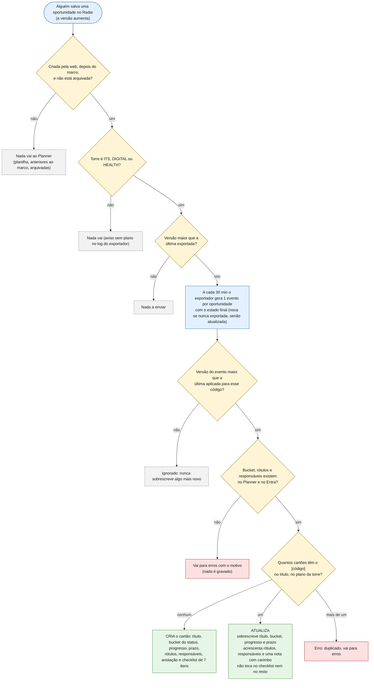
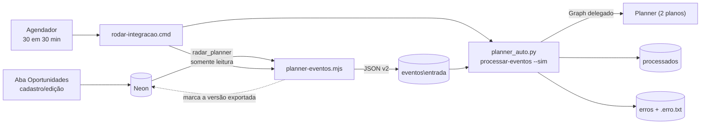

# Integração Radar → Microsoft Planner

> **Status (26/10/2026): em produção.** Exportador, `planner-auto` e agendamento estão ativos; o ciclo completo (oportunidade criada ou salva na web → cartão criado ou atualizado no Planner) roda a cada 30 minutos em dias úteis. Esteve pausado de 22/10 a 26/10 às 08:00 e foi retomado nessa data.
>
> **O que muda no cartão a cada salvamento no Radar: veja [Regra de atualização](#regra-de-atualização-o-que-acontece-no-cartão).**

Sentido único: **Radar → Planner**. O Radar é a fonte da verdade; o Planner é só a visão de acompanhamento.

## Regras decididas

- **Só o que nascer no Radar.** Oportunidades que já existiam (vindas da planilha) **não** são enviadas nem contadas. Vale apenas para as criadas pela web **depois da ativação** (marco gravado por `--ativar`, em 21/10/2026 14:00 UTC).
- **Qualquer status** gera cartão. O status define o bucket.
- **A torre define o plano:** `ITS` → *ITS Oportunidades*; `DIGITAL` e `HEALTH` → *Digital e Health - Oportunidades*. Torre vazia ou desconhecida não gera cartão (o exportador avisa).
- **O responsável vem do Radar:** é o **Pré-vendas** escolhido na oportunidade, convertido no e-mail cadastrado em *Administração → Usuários e perfis*. Hoje: Júlio César, Flávio Santanna, João Henrique e Jefferson Oliveira. O contrato aceita também uma **lista** de responsáveis (`responsaveis`), mas o Radar hoje envia um.
- **Chave do cartão = código da oportunidade** (`AAAA-NNNN`, ex.: `2026-0512`), entre colchetes no início do título. É o mesmo código que aparece na aba Oportunidades do Radar, então a oportunidade é encontrada nos dois lados pelo mesmo identificador. É também o que torna o processamento idempotente. O formato antigo `RAD-<id>` só existe no cartão de teste e como reserva para registros sem código.

## Regra de atualização: o que acontece no cartão

**Em uma frase:** toda vez que alguém **salva** uma oportunidade da web no Radar, em até 30 minutos (em dia útil, das 07h às 19h) o cartão dela no Planner é **criado**, se ainda não existe, ou **atualizado**, se já existe. O Radar **sobrescreve** só quatro campos do cartão (título, coluna, progresso e prazo), **acrescenta** rótulos, responsáveis e anotações, e **não toca** no resto. **Nada do que se faz no Planner volta para o Radar.**

### Os cinco princípios

1. **Sentido único.** O Radar é a fonte da verdade; o Planner é só a visão de acompanhamento. Mexer no cartão não altera a oportunidade.
2. **Quem manda é o último "Salvar" no Radar.** A cada salvamento, os quatro campos controlados pelo Radar voltam ao que o Radar diz, mesmo que o time os tenha mexido à mão.
3. **Só quatro campos são sobrescritos:** título, coluna (*bucket*), progresso e prazo. **Acrescentados** (nunca removidos): rótulos, responsáveis e anotações. **Nunca tocados** depois da criação: checklist, comentários, anexos, prioridade, data de início e tudo que não está nesta página.
4. **Nada é apagado:** nem cartão, nem anotação, nem checklist, nem responsável. Remover é sempre ação manual no Planner.
5. **Sem salvar no Radar, o Planner não é tocado.** O que o time mexeu à mão no Planner fica como está até o próximo salvamento da oportunidade no Radar.

### O caminho, em um desenho



### 1. Quando o Radar envia uma atualização

Uma oportunidade só vira evento se **todas** estas condições valem:

| Condição | Como o Radar confere |
|---|---|
| Foi **criada pela web** | `fonte = 'web'` (o que veio da planilha nunca é enviado) |
| Foi criada **depois do marco** de ativação | `criado_em >= planner_marco` (21/10/2026 14:00 UTC) |
| **Não está arquivada** | `arquivado_em` vazio |
| A **torre tem plano** | `ITS`, `DIGITAL` ou `HEALTH`; senão o exportador avisa "sem plano" no log |
| Há **versão nova** | `versao` da oportunidade maior que a última exportada (`planner_exportacao`) |

Pontos que costumam surpreender:

- **Qualquer edição gera atualização**, mesmo de um campo que o cartão nem mostra (por exemplo, Impostos). Cada salvamento aumenta a versão; a atualização reescreve o título, o bucket, o progresso e o prazo e acrescenta uma nota nova.
- **Várias edições entre duas rodadas viram um só envio**, com o estado final (o exportador lê a oportunidade como ela está na hora da rodada).
- **"Nova" ou "atualizada" depende de o Radar já ter exportado**, não de o cartão existir. Se o cartão foi apagado, o próximo evento "atualizada" cria um cartão novo (ver cenários).
- **Arquivar não atualiza o cartão** (ele fica como está, sem apagar nem marcar). **Restaurar** a oportunidade volta a enviá-la.
- **O envio é marcado no momento em que o evento é gerado**, não quando o Planner o aplica. Um evento que cai em `erros\` **não é reenviado sozinho** (ver "Quando algo dá errado").
- O integrador só roda **seg–sex, 07h–19h, a cada 30 minutos**, com o computador ligado. Mudanças feitas fora dessa janela esperam a próxima rodada.

### 2. O que acontece em cada campo do cartão

| Campo do cartão | Vem de (no Radar) | Na **criação** | Na **atualização** | O que o time pode fazer à mão |
|---|---|---|---|---|
| **Título** | `[código] Órgão \| Objeto \| PE: processo UASG: uasg \| DATA: dd/mm/aaaa` (até 255 caracteres) | define | **sobrescreve** | pode editar, mas é reescrito no próximo salvamento. **Nunca remova o `[código]` do início** (ver cenários) |
| **Coluna (bucket)** | status → mapa abaixo | define | **move** para a coluna do status atual | mover à mão vale só até o próximo salvamento no Radar |
| **Progresso** | status: 0%, 50% ou 100% | define | **sobrescreve** | idem. Win, Lost, No Go e Canceled marcam 100% (cartão concluído) |
| **Prazo** | data do pregão (12:00 UTC) | define | **sobrescreve**, mas se a data estiver vazia no Radar o prazo do cartão **não é limpo** | idem |
| **Rótulos** | *Licitação* e *Público*, mais *DIGITAL* ou *Health* conforme a torre | define | **acrescenta** os do Radar e mantém os do time | pode adicionar e remover os seus |
| **Responsáveis** | Pré-vendas da oportunidade (e-mail cadastrado) **mais** os `responsaveis_extras` da configuração do integrador | define | **só acrescenta** quem ainda não está; nunca remove. Sem pré-vendas/e-mail e sem extras, não altera a atribuição | pode acrescentar pessoas. Se remover à mão o pré-vendas ou um extra, a próxima atualização o atribui de novo |
| **Anotações** (descrição) | nota do Radar: código, versão, status, linha de serviço, orçamento (ou "sigiloso"), observações (até 600 caracteres) | define | **acrescenta ao final**, com o carimbo `--- Radar dd/mm/aaaa hh:mm ---`; não apaga o que o time escreveu | pode escrever livremente. O limite do Planner é 30.000 caracteres: passando disso, o **fim** é cortado e a nota nova se perde |
| **Checklist** | 7 itens padrão (`checklistPadrao` do mapa) | **só aqui** | **não toca** | marcar, incluir e remover itens é livre |
| Comentários, anexos, prioridade, data de início | — | não toca | não toca | livre |

### 3. O que acontece quando...

**No Radar**

| Alguém... | Resultado no Planner (na próxima rodada, em até 30 min) |
|---|---|
| **cria** a oportunidade (torre ITS, status Go, pré-vendas Júlio) | cartão criado no plano *ITS Oportunidades*, coluna GO, 50%, com checklist e Júlio como responsável |
| **muda o status** (Go → Win) | o cartão **vai** para a coluna do novo status (*Ganhos!* ou *WIN*), progresso 100%, e ganha uma nota nova |
| **troca o pré-vendas** | o novo responsável é **acrescentado**; o antigo **continua** atribuído (remover é manual) |
| **corrige órgão, objeto, processo, UASG ou data do pregão** | título e prazo reescritos; coluna e progresso reafirmados pelo status |
| **edita qualquer outro campo** (UF, impostos, observações...) | o cartão é "reafirmado": título, coluna, progresso e prazo voltam ao que o Radar diz e uma nota é acrescentada |
| **muda a linha de serviço de modo que a torre muda** (ex.: ITS → DIGITAL) | **cria um cartão novo** no outro plano (sem checklist) e **deixa o antigo** no plano de origem. O cartão antigo precisa ser removido à mão |
| **arquiva** | nada acontece; o cartão fica como está |
| **restaura** | volta a ser atualizada |
| (planilha) a carga diária muda a linha | nada: o que veio da planilha nunca vai ao Planner |

**No Planner**

| Alguém... | O que acontece |
|---|---|
| **move o cartão de coluna**, muda o progresso, o prazo ou o título à mão | **nada no Radar.** A mudança fica até o próximo salvamento da oportunidade no Radar, que devolve esses campos ao que o Radar manda |
| **escreve nas anotações**, marca o checklist, comenta, anexa, adiciona rótulos ou pessoas | **preservado** |
| **remove o `[código]` do título** | o integrador **não encontra o cartão** (a busca é pelo código no título) e, na próxima atualização, **cria outro cartão**, duplicando |
| **apaga o cartão** | nada acontece até o próximo salvamento no Radar; então um cartão novo é criado, **sem o checklist padrão** (que só vai na criação) |
| **duplica o cartão** (dois com o mesmo `[código]` no plano) | o evento vai para `erros\` ("mais de um cartão com a chave") até sobrar um só |
| **renomeia uma coluna ou um rótulo** do plano | o evento vai para `erros\` ("bucket/rótulo não encontrado") até o `config/planner-mapa.json` ser ajustado |
| **remove do Entra** (ou erra o e-mail de) um responsável | o evento vai para `erros\` ("responsável não encontrado") até corrigir o e-mail em *Administração → Usuários e perfis* |

### 4. Exemplo de ponta a ponta

| Quando | Quem | O que faz | O que o Planner mostra depois da rodada seguinte |
|---|---|---|---|
| 26/10, 09:10 | Ana, no Radar | cadastra a oportunidade `2026-0600` (ITS, Prospect, pré-vendas Júlio) | cartão `[2026-0600] ...` criado em **Prospect**, 0%, checklist de 7 itens, Júlio responsável |
| 09:40 | Júlio, no Planner | marca 2 itens do checklist e comenta | (nada muda no Radar) |
| 11:00 | João, no Radar | muda o status para **Go** | cartão vai para **GO**, 50%; checklist marcado e comentário **preservados**; anotação ganha `--- Radar 26/10/2026 11:30 ---` e a nota nova |
| 14:00 | Júlio, no Planner | arrasta o cartão para *Em andamento* | (nada muda no Radar) |
| 15:00 | João, no Radar | só corrige uma observação | cartão **volta para GO** e 50% (o status no Radar ainda é Go) e ganha mais uma nota |

A lição do exemplo: **para mudar a coluna de um cartão, mude o status no Radar.** Mexer só no Planner dura até o próximo salvamento da oportunidade.

### 5. Quando algo dá errado

- O evento problemático vai para `eventos\erros\` com um arquivo `.erro.txt` dizendo o motivo, e **não é reenviado sozinho** (o Radar já o marcou como exportado).
- Corrigida a causa (coluna renomeada, e-mail errado, cartão duplicado), **devolva o arquivo de `erros\` para `entrada\`**; a próxima rodada o aplica. Alternativa: salvar a oportunidade de novo no Radar, que gera um evento novo.
- Eventos antigos nunca sobrescrevem os mais novos: o integrador guarda a última versão aplicada por código e ignora versões menores ou iguais.
- Para ver o que **aconteceria** sem gravar nada: `python planner_auto.py processar-eventos --dry-run`. O histórico do que foi gravado fica em `%USERPROFILE%\.planner_auto\acoes.jsonl` (antes e depois de cada cartão).

### 6. Onde a regra está implementada e como é testada

| Parte da regra | Código | Testes que a garantem |
|---|---|---|
| **Quando** uma oportunidade vira evento (web, depois do marco, não arquivada, versão nova) | `scripts/planner-eventos.mjs` | `db/testes/planner.test.ts` (executa a consulta real do script num banco criado do zero) |
| **O que** o evento leva (título, bucket, progresso, prazo, rótulos, nota, checklist só na criação) | `functions/_lib/planner.ts` e `config/planner-mapa.json` | `functions/_lib/planner.test.ts` e `db/testes/planner.test.ts` (todos os status de cada plano) |
| **Como** o cartão é criado ou atualizado (sobrescreve, acrescenta, nunca remove) | `planner-auto/planner_auto.py` (`planeja` e `aplica`) | `planner-auto/tests/test_planner_auto.py` (classe `RegraDeAtualizacao`: simula o Planner e confere cada gravação) |
| Tabela de status → bucket desta página | `config/planner-mapa.json` | `src/planner-doc.test.ts` (falha se a tabela divergir do mapa) |

Para rodar: `npm test` (parte TypeScript e banco) e `python -m unittest discover -s planner-auto/tests` (parte Python; também roda no CI).

### 7. Como mudar a regra

1. Mude o código na parte certa da tabela acima (por exemplo, para o Radar **parar de sobrescrever** o progresso, é `aplica` em `planner_auto.py`).
2. Ajuste os testes correspondentes: eles descrevem a regra em português e vão falhar na parte que você mudou.
3. **Atualize esta página** na mesma mudança. O teste `src/planner-doc.test.ts` pega divergência na tabela de status; o restante depende de você.
4. Se mudou o mapa (colunas, rótulos, progresso, checklist), rode `python planner_auto.py inspecionar` na máquina da integração para conferir com o Planner real.

## Componentes

| Peça | Onde | Função |
|---|---|---|
| Exportador `scripts/planner-eventos.mjs` | este repositório | lê o banco (`radar_planner`) e grava eventos JSON v2 |
| `planner-auto` ([`planner-auto/`](../planner-auto/)) | este repositório; roda em `C:\Users\CTC\planner-auto` | login no Graph, `inspecionar`, `processar-eventos` |
| `rodar-integracao.cmd` | `planner-auto/` | roda as duas etapas em sequência, com log |
| Tarefa `Radar-Planner integracao` | Agendador do Windows | seg–sex, 07h–19h, a cada 30 min |
| Mapa `config/planner-mapa.json` | este repositório | planos, buckets, rótulos, progresso, checklist padrão |
| Tabelas `planner_marco` e `planner_exportacao` | Neon (migração 003) | marco de ativação e versão já exportada por oportunidade |



## Contrato do evento (v2)

Arquivo `AAAAMMDD-HHMM_<código>_<tipo>.json` em `eventos\entrada\`:

```json
{
  "versao": "2",
  "tipo": "oportunidade_nova",            // ou "oportunidade_atualizada"
  "chave": "2026-0077",                   // código da oportunidade (AAAA-NNNN)
  "versaoOrigem": 3,                      // versão da oportunidade no Radar
  "origem": "Radar",
  "geradoEm": "2026-10-21T14:30:00.000Z",
  "plano": "<planId>",
  "planoNome": "ITS Oportunidades",
  "cartao": {
    "titulo": "[2026-0077] SEDES | Link dedicado | PE: 24/2026 UASG: 158443 | DATA: 05/11/2026",
    "status": "Go",
    "bucket": "GO",                        // nome EXATO do bucket no plano
    "progresso": 50,                       // 0, 50 ou 100
    "prazo": "2026-11-05T12:00:00Z",
    "responsavel": "pessoa@ctctech.com.br",   // ou "responsaveis": [ ... ]; vazio = não alterar
    "rotulos": ["Licitação", "Público"],
    "nota": "Radar 2026-0077 (v3) — status: Go. ...",
    "checklist": ["Análise de edital", "..."]       // só na criação
  }
}
```

## O que o `processar-eventos` faz

Para cada arquivo de `entrada\`, em ordem de nome, pela `chave`:
- **`oportunidade_nova`:** procura cartão com `[<código>]` no título, no plano indicado. Se não existir, cria (bucket, rótulos, responsáveis, prazo, progresso, nota em *Anotações*, checklist). Se já existir, trata como atualização.
- **`oportunidade_atualizada`:** acha o cartão pela chave e atualiza título, bucket, progresso e prazo; **acrescenta** rótulos, responsáveis e a nota (não apaga o que o time escreveu; nunca remove ninguém). Não mexe no checklist. Se não achar o cartão, cria um novo. Detalhes campo a campo: [Regra de atualização](#regra-de-atualização-o-que-acontece-no-cartão).
- Depois move o arquivo para `processados\` (ou `erros\` com o motivo).

### Regras do consumidor
1. **Versão:** guarda a última `versaoOrigem` aplicada por `chave` (`%USERPROFILE%\.planner_auto\estado_radar.json`) e **ignora** eventos com versão menor ou igual. Reprocessar um evento antigo de `erros\` nunca sobrescreve um mais novo.
2. **Responsável vazio não mexe** na atribuição: o que alguém atribuiu à mão no Planner é preservado.
3. **Bucket e rótulo:** nome **exato** primeiro; senão, comparação sem caixa e sem espaços (ex.: `Em andamento ( Proposta Entregue)`). Se ainda não achar, o evento vai para `erros\`. **Nunca** cai num bucket qualquer.
4. **E-mail → usuário:** converte com `GET /users/{email}` antes de montar `assignments`; e-mail não encontrado vai para `erros\`.
5. **ETag** (`If-Match`) em toda atualização; retry em 429/503 respeitando `Retry-After`.
6. **Nunca apaga** cartões nem arquivos; só move entre pastas. Toda escrita vai para `%USERPROFILE%\.planner_auto\acoes.jsonl` (auditoria).
7. **Progresso:** o 50%/100% vindo do Radar pode sobrescrever o que o time marcou à mão.

Comandos do `planner-auto`:

| Comando | O que faz |
|---|---|
| `login` | login por código de dispositivo (cache em `%USERPROFILE%\.planner_auto\`) |
| `inspecionar [--plano ID]` | lista buckets e rótulos reais (só leitura) e confere com o `planner-mapa.json` |
| `processar-eventos --dry-run` | mostra o que seria feito em cada cartão, sem gravar |
| `processar-eventos [--sim] [--arquivo NOME]` | aplica (pergunta antes de gravar, a menos que `--sim`) |

## Mapeamento status → bucket

| Radar | ITS Oportunidades | Digital e Health | Progresso |
|---|---|---|---|
| Prospect | Prospect | Prospect | 0% |
| Go | GO | GO | 50% |
| On going | Em andamento ( Proposta Entregue) | On Going (Proposta enviada) | 50% |
| Suspended | SUSPENSOS | SUSPENSAS | 50% |
| Win | Ganhos! | WIN | 100% |
| Lost | Perdidos | Lost | 100% |
| No Go | NO GO | NO GO | 100% |
| Canceled | Revogado | Revogado | 100% |
| Validar / sem status | Preparo | Prospect | 0% |

Não têm status equivalente no Radar: *Cotação Concluída* (ITS) e *Cotações Enviadas* (Digital e Health).

## Operação

- **Variáveis** (usuário Windows, fora do Git): `DATABASE_URL_PLANNER` e `PLANNER_EVENTOS_DIR`.
- **Ativar / conferir / pausar:**
  ```powershell
  node scripts/planner-eventos.mjs --ativar       # uma vez: grava o marco (já feito em 21/10/2026)
  node scripts/planner-eventos.mjs --dry-run      # o que seria gerado, sem gravar
  Start-ScheduledTask -TaskName "Radar-Planner integracao"     # rodar agora
  Disable-ScheduledTask -TaskName "Radar-Planner integracao"   # pausar
  ```
- **Log:** `C:\Users\CTC\planner-auto\logs\integracao.log`. Se mudar o repositório de pasta, ajustar o `rodar-integracao.cmd`.
- **Cartão de teste:** `RAD-999001` (plano ITS, formato antigo de chave) foi criado na validação; apagar à mão no Planner.
- Problemas comuns: [OPERACAO.md](OPERACAO.md) §3.

## Limitações conhecidas (comportamento atual)

Estas são as consequências reais da regra de atualização; cada uma está nos testes da seção anterior. As correções possíveis estão em [ROADMAP.md](ROADMAP.md).

- **Mudar a torre não move o cartão:** cria um cartão **novo** no plano da torre nova (sem checklist) e **deixa o antigo** no plano de origem; removê-lo é manual.
- **Arquivar** a oportunidade no Radar não atualiza o cartão (ele fica como está). Restaurar volta a atualizar.
- **Apagar o cartão** no Planner não o recria na hora: o próximo salvamento da oportunidade no Radar cria outro, sem o checklist padrão.
- **Tirar o `[código]` do título** faz o integrador não achar o cartão e criar um duplicado na próxima atualização.
- **Um evento em `erros\` não é reenviado sozinho**: é preciso corrigir a causa e devolver o arquivo a `entrada\`, ou salvar a oportunidade de novo.
- **Todo salvamento no Radar reafirma** título, coluna, progresso e prazo, desfazendo o que o time tenha mexido à mão nesses campos.
- **Anotações** com 30.000 caracteres perdem a nota nova (o fim é cortado).
- Depende do computador ligado e logado; o login Microsoft expira após ~90 dias sem uso.
- Eventos dos Fluxos 1 a 3 (parecer GO/NO GO) e agenda ficam para uma fase futura (usam outra chave: UASG + ano + pregão). Ver [ROADMAP.md](ROADMAP.md).
