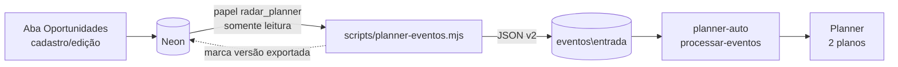

# Integração Radar → Microsoft Planner

Sentido único: **Radar → Planner**. O Radar é a fonte da verdade; o Planner é só a visão de acompanhamento.

## Regras decididas

- **Só o que nascer no Radar.** Oportunidades que já existiam (vindas da planilha) **não** são enviadas nem contadas. Vale apenas para as criadas pela web **depois da ativação** (`--ativar` grava o marco).
- **Qualquer status** gera cartão. O status define o bucket.
- **A torre define o plano:** `ITS` → plano *ITS Oportunidades*; `DIGITAL` e `HEALTH` → plano *Digital e Health - Oportunidades*. Torre vazia ou desconhecida não gera cartão (o exportador avisa).
- **Responsável** = pré-vendas da oportunidade, pelo e-mail cadastrado em *Listas e usuários* (hoje: Júlio César e Flávio Santanna).
- **Chave do cartão:** `RAD-<id>`, entre colchetes no início do título. É o que torna o processamento idempotente.

## Como funciona



1. O exportador (`scripts/planner-eventos.mjs`) roda na máquina do `planner-auto`, logo depois do agente de carga (ou em agendamento próprio).
2. Para cada oportunidade criada pela web depois do marco e ainda não exportada (ou com `versao` maior que a exportada) ele grava um arquivo `AAAAMMDD-HHMM_RAD-<id>_<tipo>.json` em `eventos\entrada\` e registra a versão em `planner_exportacao`.
3. O `planner-auto` consome a pasta (`processar-eventos`, item **a implementar** da Fase 2a da documentação do `planner-auto`).

## Contrato do evento (v2)

```json
{
  "versao": "2",
  "tipo": "oportunidade_nova",            // ou "oportunidade_atualizada"
  "chave": "RAD-77",
  "origem": "Radar",
  "geradoEm": "2026-10-21T14:30:00.000Z",
  "plano": "ZiZ73_n76Uu8gXXYbmIQ0mUAD-k0",
  "planoNome": "ITS Oportunidades",
  "cartao": {
    "titulo": "[RAD-77] SEDES | Link dedicado | PE: 24/2026 UASG: 158443 | DATA: 05/11/2026",
    "status": "Go",
    "bucket": "GO",                        // nome EXATO do bucket no plano
    "progresso": 50,                       // 0, 50 ou 100
    "prazo": "2026-11-05T12:00:00Z",
    "responsavel": "julio.silva@ctctech.com.br",   // null = sem responsável
    "rotulos": ["Licitação", "Público"],
    "nota": "Radar #77 (v1) — status: Go. ...",
    "checklist": ["Análise de edital", "..."]       // só na criação
  }
}
```

O que o `processar-eventos` deve fazer, por `chave`:
- **`oportunidade_nova`:** procurar cartão com `[RAD-<id>]` no título; se **não existir**, criar (bucket, rótulos, responsável, prazo, nota em *Anotações*, checklist). Se já existir, tratar como atualização.
- **`oportunidade_atualizada`:** achar o cartão pela chave e atualizar título, bucket, progresso, prazo, responsável e acrescentar a nota (não apagar anotações do time). **Nunca desmarcar** itens de checklist já concluídos.
- Usar `If-Match` (ETag) nas atualizações e mover o arquivo para `processados\` (ou `erros\` com o motivo).
- Os **nomes** de bucket e rótulo vêm de [`config/planner-mapa.json`](../config/planner-mapa.json), extraídos dos exports de 21/10/2026. Se alguém renomear um bucket no Planner, atualize esse arquivo.

## Mapeamento status → bucket

| Radar | ITS Oportunidades | Digital e Health |
|---|---|---|
| Prospect | Prospect | Prospect |
| Go | GO | GO |
| On going | Em andamento ( Proposta Entregue) | On Going (Proposta enviada) |
| Win | Ganhos! | WIN |
| Lost | Perdidos | Lost |
| No Go | NO GO | NO GO |
| Suspended | SUSPENSOS | SUSPENSAS |
| Canceled | Revogado | Revogado |
| Validar / sem status | Preparo | Prospect |

Win, Lost, No Go e Canceled saem como **concluídos** (100%). Go, On going e Suspended como **em andamento** (50%). Prospect e sem status como **não iniciados** (0%).

Hoje os buckets *Cotação Concluída* (ITS) e *Cotações Enviadas* (Digital e Health) não têm status equivalente no Radar e ficam de fora.

## Operação

Variáveis na máquina do agente (fora do Git):

```powershell
[Environment]::SetEnvironmentVariable("DATABASE_URL_PLANNER", "<string do radar_planner>", "User")
[Environment]::SetEnvironmentVariable("PLANNER_EVENTOS_DIR", "C:\caminho\planner-auto\eventos\entrada", "User")
```

```powershell
node scripts/planner-eventos.mjs --ativar     # uma vez: liga a integração (marco = agora)
node scripts/planner-eventos.mjs --dry-run    # mostra o que seria gerado, sem gravar
node scripts/planner-eventos.mjs              # gera os eventos e marca como exportados
```

Limitações da primeira versão: oportunidade **arquivada** no Radar não é propagada ao cartão; a mudança de torre não move o cartão entre planos; apagar o cartão no Planner não o recria (a versão exportada já foi marcada).
