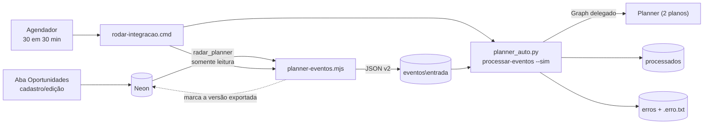

# Integração Radar → Microsoft Planner

> **Status (21/10/2026): em produção.** Exportador, `planner-auto` e agendamento estão ativos. Primeiro cartão de teste criado e conferido. O ciclo completo (oportunidade criada na web → cartão no Planner) roda a cada 30 minutos em dias úteis.

Sentido único: **Radar → Planner**. O Radar é a fonte da verdade; o Planner é só a visão de acompanhamento.

## Regras decididas

- **Só o que nascer no Radar.** Oportunidades que já existiam (vindas da planilha) **não** são enviadas nem contadas. Vale apenas para as criadas pela web **depois da ativação** (marco gravado por `--ativar`, em 21/10/2026 14:00 UTC).
- **Qualquer status** gera cartão. O status define o bucket.
- **A torre define o plano:** `ITS` → *ITS Oportunidades*; `DIGITAL` e `HEALTH` → *Digital e Health - Oportunidades*. Torre vazia ou desconhecida não gera cartão (o exportador avisa).
- **O responsável vem do Radar:** é o **Pré-vendas** escolhido na oportunidade, convertido no e-mail cadastrado em *Administração → Usuários e perfis*. Hoje: Júlio César, Flávio Santanna, João Henrique e Jefferson Oliveira. O contrato aceita também uma **lista** de responsáveis (`responsaveis`), mas o Radar hoje envia um.
- **Chave do cartão = código da oportunidade** (`AAAA-NNNN`, ex.: `2026-0512`), entre colchetes no início do título. É o mesmo código que aparece na aba Oportunidades do Radar, então a oportunidade é encontrada nos dois lados pelo mesmo identificador. É também o que torna o processamento idempotente. O formato antigo `RAD-<id>` só existe no cartão de teste e como reserva para registros sem código.

## Componentes

| Peça | Onde | Função |
|---|---|---|
| Exportador `scripts/planner-eventos.mjs` | este repositório | lê o banco (`radar_planner`) e grava eventos JSON v2 |
| `planner-auto` ([`planner-auto/`](../planner-auto/)) | este repositório; roda em `C:\Users\CTC\planner-auto` | login no Graph, `inspecionar`, `processar-eventos` |
| `rodar-integracao.cmd` | `planner-auto/` | roda as duas etapas em sequência, com log |
| Tarefa `Radar-Planner integracao` | Agendador do Windows | seg–sex, 07h–19h, a cada 30 min |
| Mapa `config/planner-mapa.json` | este repositório | planos, buckets, rótulos, progresso, checklist padrão |
| Tabelas `planner_marco` e `planner_exportacao` | Neon (migração 003) | marco de ativação e versão já exportada por oportunidade |



## Contrato do evento (v2)

Arquivo `AAAAMMDD-HHMM_<código>_<tipo>.json` em `eventos\entrada\`:

```json
{
  "versao": "2",
  "tipo": "oportunidade_nova",            // ou "oportunidade_atualizada"
  "chave": "2026-0077",                   // código da oportunidade (AAAA-NNNN)
  "versaoOrigem": 3,                      // versão da oportunidade no Radar
  "origem": "Radar",
  "geradoEm": "2026-10-21T14:30:00.000Z",
  "plano": "<planId>",
  "planoNome": "ITS Oportunidades",
  "cartao": {
    "titulo": "[2026-0077] SEDES | Link dedicado | PE: 24/2026 UASG: 158443 | DATA: 05/11/2026",
    "status": "Go",
    "bucket": "GO",                        // nome EXATO do bucket no plano
    "progresso": 50,                       // 0, 50 ou 100
    "prazo": "2026-11-05T12:00:00Z",
    "responsavel": "pessoa@ctctech.com.br",   // ou "responsaveis": [ ... ]; vazio = não alterar
    "rotulos": ["Licitação", "Público"],
    "nota": "Radar 2026-0077 (v3) — status: Go. ...",
    "checklist": ["Análise de edital", "..."]       // só na criação
  }
}
```

## O que o `processar-eventos` faz

Para cada arquivo de `entrada\`, em ordem de nome, pela `chave`:
- **`oportunidade_nova`:** procura cartão com `[<código>]` no título, no plano indicado. Se não existir, cria (bucket, rótulos, responsáveis, prazo, progresso, nota em *Anotações*, checklist). Se já existir, trata como atualização.
- **`oportunidade_atualizada`:** acha o cartão pela chave e atualiza título, bucket, progresso e prazo; **acrescenta** a nota (não apaga o que o time escreveu) e **acrescenta** responsáveis (nunca remove). Nunca desmarca item de checklist concluído.
- Depois move o arquivo para `processados\` (ou `erros\` com o motivo).

### Regras do consumidor
1. **Versão:** guarda a última `versaoOrigem` aplicada por `chave` (`%USERPROFILE%\.planner_auto\estado_radar.json`) e **ignora** eventos com versão menor ou igual. Reprocessar um evento antigo de `erros\` nunca sobrescreve um mais novo.
2. **Responsável vazio não mexe** na atribuição: o que alguém atribuiu à mão no Planner é preservado.
3. **Bucket e rótulo:** nome **exato** primeiro; senão, comparação sem caixa e sem espaços (ex.: `Em andamento ( Proposta Entregue)`). Se ainda não achar, o evento vai para `erros\`. **Nunca** cai num bucket qualquer.
4. **E-mail → usuário:** converte com `GET /users/{email}` antes de montar `assignments`; e-mail não encontrado vai para `erros\`.
5. **ETag** (`If-Match`) em toda atualização; retry em 429/503 respeitando `Retry-After`.
6. **Nunca apaga** cartões nem arquivos; só move entre pastas. Toda escrita vai para `%USERPROFILE%\.planner_auto\acoes.jsonl` (auditoria).
7. **Progresso:** o 50%/100% vindo do Radar pode sobrescrever o que o time marcou à mão.

Comandos do `planner-auto`:

| Comando | O que faz |
|---|---|
| `login` | login por código de dispositivo (cache em `%USERPROFILE%\.planner_auto\`) |
| `inspecionar [--plano ID]` | lista buckets e rótulos reais (só leitura) e confere com o `planner-mapa.json` |
| `processar-eventos --dry-run` | mostra o que seria feito em cada cartão, sem gravar |
| `processar-eventos [--sim] [--arquivo NOME]` | aplica (pergunta antes de gravar, a menos que `--sim`) |

## Mapeamento status → bucket

| Radar | ITS Oportunidades | Digital e Health | Progresso |
|---|---|---|---|
| Prospect | Prospect | Prospect | 0% |
| Go | GO | GO | 50% |
| On going | Em andamento ( Proposta Entregue) | On Going (Proposta enviada) | 50% |
| Suspended | SUSPENSOS | SUSPENSAS | 50% |
| Win | Ganhos! | WIN | 100% |
| Lost | Perdidos | Lost | 100% |
| No Go | NO GO | NO GO | 100% |
| Canceled | Revogado | Revogado | 100% |
| Validar / sem status | Preparo | Prospect | 0% |

Não têm status equivalente no Radar: *Cotação Concluída* (ITS) e *Cotações Enviadas* (Digital e Health).

## Operação

- **Variáveis** (usuário Windows, fora do Git): `DATABASE_URL_PLANNER` e `PLANNER_EVENTOS_DIR`.
- **Ativar / conferir / pausar:**
  ```powershell
  node scripts/planner-eventos.mjs --ativar       # uma vez: grava o marco (já feito em 21/10/2026)
  node scripts/planner-eventos.mjs --dry-run      # o que seria gerado, sem gravar
  Start-ScheduledTask -TaskName "Radar-Planner integracao"     # rodar agora
  Disable-ScheduledTask -TaskName "Radar-Planner integracao"   # pausar
  ```
- **Log:** `C:\Users\CTC\planner-auto\logs\integracao.log`. Se mudar o repositório de pasta, ajustar o `rodar-integracao.cmd`.
- **Cartão de teste:** `RAD-999001` (plano ITS, formato antigo de chave) foi criado na validação; apagar à mão no Planner.
- Problemas comuns: [OPERACAO.md](OPERACAO.md) §3.

## Limitações da versão atual
- Oportunidade **arquivada** no Radar não atualiza o cartão.
- **Mudar a torre** não move o cartão entre planos.
- **Apagar o cartão** no Planner não o recria (a versão já foi marcada como exportada).
- Depende do computador ligado e logado; o login Microsoft expira após ~90 dias sem uso.
- Eventos dos Fluxos 1 a 3 (parecer GO/NO GO) e agenda ficam para uma fase futura (usam outra chave: UASG + ano + pregão). Ver [ROADMAP.md](ROADMAP.md).
