# Radar Pré-Vendas: arquitetura atual e requisitos de infraestrutura

| | |
|---|---|
| **Versão / data** | 2.0 · 23/11/2026 |
| **Para quem** | time de infraestrutura e segurança (provisionar, liberar rede, auditar) e quem opera o Radar |
| **O que cobre** | as **três camadas** do Radar (**front**, **workers** e **banco**), os serviços de apoio, a rede, os segredos, a capacidade e os riscos. A **Parte E** é o requisito da máquina de IP fixo (opcional, só se a ConLicitações mantiver a restrição de IP) |
| **Fonte dos fatos** | o repositório (`wrangler.toml`, `.github/workflows/`, `functions/`, `db/migrations/`, `package.json`) e os documentos [MIGRACAO-AZURE.md](MIGRACAO-AZURE.md), [PLANO-DE-ACAO-BANCO.md](PLANO-DE-ACAO-BANCO.md) e [CONTAS-E-SERVICOS.md](CONTAS-E-SERVICOS.md). Itens com **(confirmar)** não puderam ser verificados a partir do repositório e precisam ser conferidos no painel do serviço |

> **Mudança desde a versão 1.1:** o banco de produção saiu do Neon e está no **Azure Database for PostgreSQL** (18/11/2026). Todo o resto do Radar roda em serviços de nuvem gerenciados (Cloudflare e GitHub): **nenhuma máquina própria é necessária**, exceto, se for o caso, a da Parte E.

## Parte A. Arquitetura atual, em três camadas

| Camada | O que é | Onde roda | Quem a usa |
|---|---|---|---|
| **1. Front** | página única (SPA) em arquivos estáticos | Cloudflare Pages, borda global | usuários do time, pelo navegador |
| **2a. Workers (tempo real)** | API em `/api/*`: painel, cadastro, administração, CNPJ, API externa, MCP remoto, diagnóstico e proxies das fontes públicas | Cloudflare Pages Functions (runtime Workers) | o front, aplicações externas e agentes de IA |
| **2b. Workers (rotinas)** | Planner, e-mails, monitor, backup, espelho, vigia, migrações e CI/CD | GitHub Actions (runners Ubuntu), agendados ou acionados pelo Radar | o próprio Radar, sem máquina de pessoa |
| **3. Banco** | PostgreSQL com a regra de negócio, o histórico e os papéis de mínimo privilégio | Azure Database for PostgreSQL 17, Brazil South | as Functions e as rotinas, cada um com o seu papel |

**Regra de ouro:** nenhum componente fala com o banco com mais privilégio do que precisa (7 papéis, ver B.3). O front nunca fala com o banco: só chama a API.

Os diagramas de apoio estão em [DIAGRAMAS.md](DIAGRAMAS.md): **D20** (camadas, acima), **D21** (rede e portas, na Parte C) e **D22** (anatomia de uma requisição `/api`, com as marcas de diagnóstico). Os detalhes de cada fluxo (cadastro, Planner, e-mail, backup, CI/CD) estão nos demais diagramas e em [ARQUITETURA.md](ARQUITETURA.md).

## Parte B. Requisitos por camada

### B.1 Front (Cloudflare Pages)

| Item | Requisito / estado atual |
|---|---|
| Plataforma | Cloudflare Pages, projeto `radar-prevendas`, endereço `https://radar-prevendas.pages.dev` (sem domínio próprio). Plano **Free** (confirmado pelo responsável em 23/11/2026; não há orçamento para mudar de plano) |
| Conteúdo | SPA com React 19, TypeScript, Vite 8 e Tailwind 4, servida como arquivos estáticos. Sem servidor de aplicação |
| Build | **Node 22** (`.nvmrc`; `engines >= 22`) e **npm 10** (o `package-lock.json` precisa ser gerado com npm 10, senão o `npm ci` do CI falha). Saída em `dist/`, com orçamento de tamanho do bundle conferido no CI |
| Entrega | `wrangler pages deploy dist` pelo workflow *Pipeline* (push na `main` = produção; cada PR = pré-visualização `pr-N.pages.dev`). Rollback: rodar o Pipeline com o commit anterior |
| Variáveis de build (públicas) | `VITE_API_URL=/api`; `VITE_ALLOW_MOCK_FALLBACK=false` em produção (sem API o painel mostra erro, nunca números falsos). Nada secreto usa o prefixo `VITE_` |
| Cabeçalhos de segurança | `public/_headers`: CSP restritiva (`script-src 'self'`, `connect-src 'self'` e login Microsoft), HSTS, `X-Frame-Options: DENY`, `noindex` |
| Login | Cloudflare Access (Zero Trust, plano Free): equipe `ctctech-radar`, código por e-mail, política `@ctctech.com.br`, sessão de 24 h. **Bypass** só em `/api/externo/*` (chamadas servidor a servidor, com chave) |
| Usuário final | navegador atual (Chrome, Edge, Firefox ou Safari), sem instalação. Rede: HTTPS 443 para `radar-prevendas.pages.dev` e `ctctech-radar.cloudflareaccess.com` |
| Pré-visualização na Vercel | `vercel.json` tem reescritas de `/pncp`, `/comprasgov` e `/conlicitacao`; há uma verificação da Vercel nos PRs. Papel secundário, fora do caminho de produção **(confirmar se segue em uso)** |

### B.2 Workers

#### B.2a Pages Functions (`/api/*`, tempo real)

| Item | Requisito / estado atual |
|---|---|
| Runtime | Cloudflare Workers, com `compatibility_flags = ["nodejs_compat"]` e `compatibility_date = 2026-10-09` (`wrangler.toml`) |
| Banco | driver `postgres` **3.4.x** por TCP (flag `nodejs_compat`), TLS obrigatório. **Não subir para a v4:** a v4 entrou em 23/11/2026, `/api/rows` passou a falhar com 503 para alguns usuários e voltamos à 3.4.x (PR #159); o Dependabot ignora *major* do `postgres` |
| Conexões | uma conexão curta por requisição (`max: 1`, ociosa fecha em 5 s). Sem PgBouncer no Azure Burstable. Se o uso crescer: **Hyperdrive** na frente do banco (ver B.3) |
| Rotas | painel (`/api/rows`, `/api/status`); cadastro (`/api/oportunidades*`, `/api/opcoes`, `/api/linhas-torre`, `/api/me`); administração (`/api/usuarios`, `/api/email-config*`, `/api/api-clientes*`); CNPJ (`/api/cnpj/:cnpj`); **API externa** (`/api/externo/oportunidades*`, `/api/externo/campos`, `/api/externo/mcp`); monitor (`/api/monitor-licitacoes*`); diagnóstico (`/api/diagnostico`); proxies das fontes públicas (`/pncp`, `/comprasgov`, `/conlicitacao`) |
| Autenticação das rotas | valida o JWT do Access **por conta própria** (RS256, `exp`, `iss`, `aud`); escritas exigem `x-radar-csrf` e `Origin` igual ao host; a API externa usa chave `rdr_...` (hash SHA-256 no banco, escopo leitura ou escrita, 60 requisições/min por IP e por chave) |
| Papéis do banco usados | `radar_leitor` (painel e API/MCP de leitura, só `SELECT`) e `radar_app` (cadastro, só executa as funções) |
| Observabilidade | middleware em `functions/api/_middleware.ts`: cabeçalhos `x-radar-origem`, `x-radar-req` e `server-timing`; log em uma linha JSON só para 5xx, 429 e respostas acima de 1,5 s. Ver [DIAGNOSTICO.md](DIAGNOSTICO.md) |
| Limites do plano | no Cloudflare Workers/Pages **Free**, há teto de **tempo de CPU por requisição** (10 ms) e de requisições por dia (100.000); estourar o CPU devolve erro 1102 (pode aparecer como 503). **Confirmar o plano e, se for Free, monitorar** em *Workers & Pages → projeto → Metrics*. O plano pago remove esse teto |

| Segredo / variável (Cloudflare Pages → Variables and Secrets) | Para quê |
|---|---|
| `DATABASE_URL` (segredo) | conexão do papel `radar_leitor` |
| `DATABASE_URL_APP` (segredo) | conexão do papel `radar_app` |
| `DATABASE_URL_WRITER` (segredo, se usado) | papel `radar_escritor` (sem uso desde 27/10/2026) |
| `CF_ACCESS_TEAM_DOMAIN`, `CF_ACCESS_AUD` (em `wrangler.toml`, não são segredos) | validação do JWT do Access |
| `GITHUB_DISPATCH_TOKEN` (segredo), `GITHUB_REPO` | acionar Planner e e-mails ao salvar (token só com permissão de Actions) |
| `CONLICITACAO_TOKEN` (segredo) | consulta à ConLicitações (**ainda não configurado**) |
| `ACESSO_PUBLICO` | só para emergência: `true` dispensa o Access. **Nunca** deixar ligado |

#### B.2b GitHub Actions (rotinas)

Todos rodam em `ubuntu-latest`, sem máquina de pessoa. O repositório é **público**, então os minutos de Actions não têm custo. O agendamento do GitHub é "melhor esforço" e pode atrasar; por isso o que precisa ser rápido (Planner e e-mail) é **acionado pelo Radar ao salvar** e o agendamento só cobre falhas.

| Workflow | Gatilho | Runtime | Papel do banco | Segredos | Destino externo |
|---|---|---|---|---|---|
| **Pipeline** (CI, deploy, smoke test) | PR, push na `main`, manual | Node 22 | n/a | `CLOUDFLARE_API_TOKEN`, `CLOUDFLARE_ACCOUNT_ID` | Cloudflare (`wrangler`) |
| **Migrar banco** | push em `db/migrations/**`, manual | Node 22 | dono do banco | `DATABASE_URL_MIGRACAO` | Azure PostgreSQL |
| **Planner integração** | ao salvar + a cada 5 min, seg a sex, 08h às 19h (BRT) | Node 22 e Python (`msal`, `requests`, `psycopg2-binary`, `cryptography`) | `radar_planner` | `DATABASE_URL_PLANNER`, `PLANNER_ESTADO_CHAVE`, `PLANNER_CLIENT_ID`, `PLANNER_TENANT_ID` | Microsoft Graph |
| **Enviar e-mails** | ao salvar + a cada 15 min (dia útil), de hora em hora (noite e fim de semana) | Node 22 | `radar_email` | `DATABASE_URL_EMAIL`, `SMTP_USER`, `SMTP_PASS`, `SMTP_FROM` | Gmail SMTP 465 |
| **Monitoramento de licitações** | a cada 30 min, **só se** `MONITOR_LICITACOES_ENABLED=true` | Node 22 | `radar_monitor` | `DATABASE_URL_MONITOR` | PNCP, Compras.gov |
| **Backup do banco** | 4 vezes por dia (00:47, 06:47, 12:47 e 18:47 UTC) | `pg_dump` + AES-256 + `rclone` | `radar_backup` | `DATABASE_URL_BACKUP`, `BACKUP_PASSPHRASE`, `RCLONE_DRIVE_TOKEN` | Google Drive |
| **Backup no Supabase** (espelho) | 4 vezes por dia | `pg_dump`/`pg_restore` | `radar_backup` | `DATABASE_URL_BACKUP`, `SUPABASE_DB_URL` | Supabase |
| **Vigia do backup** | a cada 6 h | Node 22 | `radar_backup` | `DATABASE_URL_BACKUP` | alerta se o backup atrasar |
| **Teste de restauração** | toda segunda-feira | Postgres temporário no runner | `radar_backup` | `RCLONE_DRIVE_TOKEN`, `BACKUP_PASSPHRASE`, `DATABASE_URL_BACKUP` | Google Drive |
| **Testes de carga e segurança** | toda segunda-feira | Node 22 | `radar_backup` | `DATABASE_URL_BACKUP` | o próprio site |
| **CodeQL** | push, PR e toda segunda-feira | GitHub | n/a | n/a | n/a |

### B.3 Banco (Azure Database for PostgreSQL)

| Item | Requisito / estado atual |
|---|---|
| Serviço | Azure Database for PostgreSQL **Flexible Server** `radar-prevendas-pg` (grupo `rg-radar-prevendas`), banco `radar`, região **Brazil South** |
| Versão e tamanho | PostgreSQL **17**, Burstable **B1ms** (1 vCore, 2 GiB), **32 GB**, sem alta disponibilidade |
| Backup | nativo de **7 dias** (restauração em um ponto no tempo) + dump criptografado no Drive (4 por dia) + espelho no Supabase |
| Segurança | **SSL obrigatório**; senhas de 32 caracteres, uma por papel; RLS ligado nas tabelas (sem políticas); papéis com `BYPASSRLS`, `NOINHERIT` e limite de **20 conexões** cada |
| Rede | firewall **aberto** (0.0.0.0 a 255.255.255.255, regra `liberar-cloudflare-github`), porque Cloudflare e GitHub saem por IPs variáveis. A proteção é TLS + senha por papel. Para fechar: **Hyperdrive** (pendência R8) |
| Migrações | `db/migrations/` (001 a 029), aplicadas só pelo workflow *Migrar banco* (controle na tabela `schema_migracoes`, cada uma em transação). Conferir a matriz de permissões depois de aplicar |
| Governança da assinatura | policies de região (só Brazil South) e de SKU (só B1ms, até 32 GB, sem HA); orçamento `radar-orcamento-gratuito` com alertas em 50%, 100% e previsão de 100% |
| Uso hoje | cerca de 11 MB (medido em 18/11/2026) e cerca de 800 oportunidades vigentes; transferência de saída estimada em 4,5 GB/mês (limite gratuito: 100 GB) |

| Papel | Quem usa | Pode | Segredo |
|---|---|---|---|
| `radar_leitor` | Functions: painel, API e MCP de leitura | `SELECT` | `DATABASE_URL` (Cloudflare) |
| `radar_app` | Functions: cadastro e API externa | `SELECT` e `EXECUTE` das funções de cadastro | `DATABASE_URL_APP` (Cloudflare) |
| `radar_escritor` | sem uso (a carga da planilha acabou em 27/10/2026) | `EXECUTE sincronizar_planilha` | `DATABASE_URL_WRITER` |
| `radar_planner` | rotina do Planner | lê oportunidades e usuários, grava só em `planner_*` | `DATABASE_URL_PLANNER` (GitHub) |
| `radar_email` | rotina de e-mails | lê e atualiza a fila | `DATABASE_URL_EMAIL` (GitHub) |
| `radar_monitor` | monitor de licitações | tabelas do monitor | `DATABASE_URL_MONITOR` (GitHub) |
| `radar_backup` | backup, espelho, vigia, testes | `pg_read_all_data` (só leitura) | `DATABASE_URL_BACKUP` (GitHub) |
| dono do banco | migrações e administração | tudo (uso excepcional) | `DATABASE_URL_MIGRACAO` (GitHub) |

Formato das conexões (o valor é só a URL): `postgresql://<papel>:<senha>@radar-prevendas-pg.postgres.database.azure.com:5432/radar?sslmode=require`.

### B.4 Serviços de apoio e fontes externas

| Serviço | Para quê | Plano / estado |
|---|---|---|
| **Supabase** (`us-east-1`) | espelho do banco, restaurado 4 vezes por dia | Free; pausa após 7 dias sem atividade (a restauração diária evita) |
| **Google Drive** | dumps criptografados (14 diários e 12 semanais) | conta dona da pasta **(confirmar)** |
| **Gmail SMTP** (`smtp.gmail.com:465`) | avisos de nova oportunidade e de mudança de status | conta e plano **(confirmar)**; limite de envio do Gmail |
| **Microsoft 365 / Planner** | cartões das oportunidades | login **delegado de uma pessoa** (expira após ~90 dias sem uso); renovação manual |
| **ConLicitações (API)** | boletins de licitações | token **ainda não configurado**; recusa chamadas do Cloudflare (restrição por IP). Ver Parte E |
| **PNCP e Compras.gov** | consulta pública de licitações | APIs públicas, sem chave |
| **APIs de CNPJ** (BrasilAPI, minhareceita.org, publica.cnpj.ws, receitaws) | razão social e matriz/filial | serviços públicos, em sequência; se caírem, o cadastro continua |
| **GitHub API** | o Radar aciona as rotinas ao salvar | token restrito a Actions |
| ~~Neon~~ | banco antigo | **desativado**; só histórico e o branch de teste de restauração antigo |

## Parte C. Rede, segredos e segurança

### C.1 Quem fala com quem (rede e portas)

| Origem | Destino | Porta / protocolo | Observação |
|---|---|---|---|
| Navegador | Cloudflare Pages | HTTPS 443 | passa pelo Access |
| Agente de IA / sistema externo | `/api/externo/*` | HTTPS 443 | chave `rdr_...` (Bypass do Access só neste caminho) |
| Functions (Cloudflare) | Azure PostgreSQL | **TCP 5432 + TLS** | IPs de saída variáveis; firewall aberto |
| Functions | `api.github.com` | HTTPS 443 | acionar Planner e e-mails |
| Functions | PNCP, Compras.gov, ConLicitações, APIs de CNPJ | HTTPS 443 | a ConLicitações recusa (restrição por IP) |
| GitHub Actions | Azure PostgreSQL | **TCP 5432 + TLS** | IPs de runners variáveis |
| GitHub Actions | Supabase | TCP + TLS | espelho |
| GitHub Actions | `smtp.gmail.com` | SMTP 465 + TLS | e-mails |
| GitHub Actions | Microsoft Graph e Google Drive | HTTPS 443 | Planner e backup |

**Entrada:** nenhuma porta é aberta em máquina nossa; tudo entra pelo Cloudflare. **Saída:** como Cloudflare e GitHub usam IPs variáveis, o banco não consegue restringir por origem; o controle é TLS obrigatório, senha longa por papel e, no futuro, o Hyperdrive.

### C.2 Segredos

Os valores **nunca** ficam no Git (o repositório é público): só os nomes, nas tabelas de B.2 e B.3. Moram em **GitHub → Settings → Secrets and variables → Actions** (rotinas) e em **Cloudflare Pages → Variables and Secrets** (Functions). Variáveis não secretas do GitHub: `APP_URL`, `SITE_URL`, `SUPABASE_URL`, `MONITOR_LICITACOES_ENABLED`, `MS_CLIENT_ID`, `MS_TENANT_ID`, `DEMO_MODE`. Rotação e custódia: [OPERACAO.md](OPERACAO.md) e [CONTAS-E-SERVICOS.md](CONTAS-E-SERVICOS.md).

### C.3 Camadas de proteção

1. **Borda:** Cloudflare Access (`@ctctech.com.br`).
2. **API:** JWT do Access validado pela própria API; autor sempre vindo do JWT, nunca do corpo.
3. **CSRF** nas escritas; **Zod** no formato; **regras de negócio no banco** (fonte da verdade).
4. **Banco:** papéis de mínimo privilégio, funções de escrita sem `EXECUTE` para `PUBLIC`, TLS obrigatório.
5. **API externa:** chave por aplicação com escopo (a de leitura só consulta, a de escrita só cria), limite de requisições, validação rígida e consultas pelo papel `radar_leitor`.
6. **Dados em IA de terceiros:** quem usa o MCP ou a API de leitura com uma IA envia dados das oportunidades (inclusive valores e custos) a esse provedor; usar contas corporativas e a aprovação de segurança/LGPD ([MCP-REMOTO.md](MCP-REMOTO.md)).

## Parte D. Operação, capacidade e riscos

### D.1 Como saber de onde veio um erro

Toda resposta do Radar leva `x-radar-origem`, `x-radar-req` e `server-timing` ([D22](DIAGRAMAS.md#d22--anatomia-de-uma-requisição-api-onde-cada-marca-é-criada)). **Erro sem `x-radar-origem` não foi gerado pelo Radar** (Cloudflare, rede ou proxy). `GET /api/diagnostico` (com login) testa a configuração, o banco e a consulta do painel, com tempos; o aviso de erro do painel tem o botão **Copiar diagnóstico completo**. Guia: [DIAGNOSTICO.md](DIAGNOSTICO.md).

### D.2 Capacidade e limites

| Recurso | Limite | Uso / risco |
|---|---|---|
| Functions: CPU por requisição | 10 ms no plano Free (confirmado) | `/api/rows` é a rota mais pesada (hoje cerca de 800 linhas) e cresce com a base. **Mitigado sem custo:** o Postgres devolve as linhas já em JSON e o Worker só repassa o texto (`functions/_lib/painel.ts`), o que reduziu em cerca de **47% o trabalho do driver** na medição local (`npm run medir:painel`). Continuar monitorando "CPU time" e "Exceeded CPU" nas métricas do Cloudflare |
| Functions: requisições por dia | 100.000 no plano Free (confirmado) | folga grande para o uso atual |
| Banco: conexões | 20 por papel; sem PgBouncer | cada requisição abre uma conexão curta; Hyperdrive resolve se o uso crescer |
| Banco: tamanho | 32 GB | em uso, cerca de 11 MB |
| Banco: transferência | 100 GB/mês gratuitos | cerca de 4,5 GB/mês |
| GitHub Actions | sem custo (repositório público) | agendamento "melhor esforço" pode atrasar |
| Supabase Free | pausa após 7 dias sem atividade | a restauração a cada 6 h evita |

**RPO:** até cerca de 6 h (backup a cada 6 h; o vigia tolera 12 h), mais 7 dias de pontos de restauração nativos. **RTO:** depende de a senha dos backups (`BACKUP_PASSPHRASE`) estar guardada no cofre da empresa (pendência R1).

### D.3 Riscos e pendências de infraestrutura

| # | Risco / pendência | Prazo ou gatilho | Referência |
|---|---|---|---|
| 1 | **Assinatura Free Trial do Azure**: o crédito de 30 dias acaba em cerca de **17/12/2026** e o Postgres gratuito vale 12 meses (≈ 17/11/2027). Decidir: converter para pay-as-you-go ou migrar | até 10/12/2026 | [PLANO-DE-ACAO-BANCO.md](PLANO-DE-ACAO-BANCO.md) (D1, D4) |
| 2 | **Firewall do banco aberto** para qualquer origem (protegido só por TLS e senha) | adotar Hyperdrive | R8 |
| 3 | **`BACKUP_PASSPHRASE` só existe como segredo do GitHub** (não dá para ler de volta) | guardar no cofre, com 2 pessoas | R1 |
| 4 | **Cloudflare no plano Free** (sem orçamento para pagar): o teto de CPU das Functions (10 ms) é o limite mais apertado e `/api/rows` é a rota mais pesada | já mitigado no código (D.2); monitorar "CPU time" no painel. Se ainda estourar: Hyperdrive (tem camada gratuita) | D.2 |
| 5 | **Banco e repositório em contas fora da organização corporativa** | centralizar | [CONTAS-E-SERVICOS.md](CONTAS-E-SERVICOS.md) |
| 6 | **Login do Planner é de uma pessoa** e expira em ~90 dias sem uso | app do Entra com permissão de aplicativo | [INTEGRACAO-PLANNER.md](INTEGRACAO-PLANNER.md) |
| 7 | **Gmail como remetente** (senha de app, limite de envio) | remetente Workspace ou serviço transacional | [CONTAS-E-SERVICOS.md](CONTAS-E-SERVICOS.md) |
| 8 | **ConLicitações** recusa o Cloudflare (restrição de IP) | pedir a liberação; se não vier, Parte E | Parte E |
| 9 | **Branch `main` ainda sem proteção** (PR + checks obrigatórios) | quando o responsável ativar | [SECURITY.md](../SECURITY.md) |
| 10 | O check **"Cloudflare Pages"** vermelho em PRs é a integração Git do painel (configuração), não o deploy do Pipeline | corrigir no painel ou desligar a integração Git | pendência conhecida (configuração no painel do Cloudflare) |

---

## Parte E. Máquina de IP fixo para a ConLicitações (opcional)

> Esta parte é o requisito da **versão 1.1** (12/11/2026), mantido porque ainda vale se a ConLicitações não retirar a restrição de IP. Onde ela falava em "Neon", leia o **banco do Azure**: o destino é o servidor `radar-prevendas-pg.postgres.database.azure.com` na **porta TCP 5432 com TLS**.

### E.1 Por que uma máquina

A API da ConLicitações (`consultaonline.conlicitacao.com.br/api`) recusa o token do Radar (HTTP 401) quando chamada pelo Cloudflare Pages. A suspeita é **restrição por IP de origem**: o Cloudflare sai por IPs variáveis, que não dá para cadastrar na ConLicitações. Uma máquina com **IP público fixo e saída dedicada** resolve, porque esse IP é informado à ConLicitações para liberação.

> **Causa confirmada em 12/11/2026:** o token é válido (a consulta retornou HTTP 200 a partir de um IP liberado, pela VPN) e a ConLicitações recusa as chamadas feitas pelo Cloudflare Pages (HTTP 401, "Token inválido ou IP de origem não cadastrado"). É restrição por IP de origem. **A máquina só é necessária se a ConLicitações não retirar a restrição** (ver seção E.10); pedir isso a eles vem primeiro.

### E.2 Resumo para quem vai provisionar

| Item | Mínimo (funciona) | **Recomendado (produção)** |
|---|---|---|
| Sistema operacional | Linux 64 bits com suporte vigente (Ubuntu Server 22.04/24.04 LTS ou equivalente) ou Windows Server 2022 | **Ubuntu Server 24.04 LTS** (ou o padrão de servidores da empresa) |
| vCPU | 1 | **2** |
| Memória | 2 GB | **4 GB** (Windows Server: mínimo 4 GB) |
| Disco | 20 GB (Linux) / 60 GB (Windows) | **40 GB SSD** (Linux) |
| **IP público** | **Fixo, de saída (NAT/Elastic IP/IP reservado), exclusivo da máquina ou de um grupo conhecido** | idem, com o endereço **documentado e comunicado à ConLicitações** |
| Rede de entrada | **Nenhuma porta aberta** para a internet (nada escuta conexões) | idem; administração só pela VPN/bastion da empresa |
| Rede de saída | HTTPS (443) para os destinos da seção E.5 | idem, com lista de liberação |
| Disponibilidade | Dias úteis, 07:00 às 20:00 (horário de Brasília) | **24 x 7**, sem suspensão nem hibernação |
| Fuso e hora | América/São Paulo, NTP ativo | idem |
| Software | **Node.js 22 LTS** (o `package.json` exige `>=22`), Git | idem, com atualizações de segurança automáticas |
| Conta de serviço | Usuário dedicado, **sem privilégio de administrador** | idem |

Os valores são para uma carga muito pequena (ver seção E.3); sobram recursos de propósito. Pode ser a menor instância/VM que o time de infraestrutura oferece, desde que tenha **IP fixo**.

### E.3 O que vai rodar e carga de trabalho

Um **coletor** em lote (Node.js), não um serviço web. A cada execução ele:

1. lê o catálogo de filtros da conta (`GET /filtros`);
2. lê o último boletim de cada filtro (`GET /boletim/{id}?page=1&per_page=100`);
3. normaliza licitações e acompanhamentos (inclui diligências e esclarecimentos, quando a ConLicitações os fornecer);
4. entrega o resultado ao Radar (seção E.6).

| Medida | Valor |
|---|---|
| Frequência prevista | a cada 30 minutos em dias úteis (igual ao monitor atual); ajustável |
| Chamadas por execução | 1 + número de filtros da conta (dezenas no máximo, **estimativa**) |
| Tráfego por execução | menos de 5 MB (**estimativa**) |
| Duração de uma execução | segundos a poucos minutos (timeout por chamada: 20 s) |
| Memória em uso | cerca de 150 a 300 MB durante a execução (**estimativa**) |
| Processos simultâneos | 1 (a rotina deve usar trava para não sobrepor execuções) |
| Armazenamento local | só código, dependências (`npm ci`, ~0,5 GB) e logs; nenhum dado de negócio permanece na máquina |

Números marcados como **estimativa** serão confirmados no piloto (seção E.9).

### E.4 Software e configuração

- **Node.js 22 LTS** e Git. Dependências instaladas com `npm ci` a partir do repositório (o repositório é público; a máquina só **baixa** o código).
- **Agendador do sistema** (systemd timer ou cron no Linux; Agendador de Tarefas no Windows) chamando o script a cada 30 minutos. A execução deve registrar código de saída e hora.
- **Atualização do código:** `git pull` controlado (manual ou por tarefa agendada), com a versão fixada por tag/commit aprovado.
- **Relógio sincronizado** (NTP): os registros de snapshot e evento usam a hora do servidor.

### E.5 Rede: destinos de saída (lista de liberação)

Somente **saída**, por HTTPS (443), a partir do IP fixo:

| Destino | Para quê |
|---|---|
| `consultaonline.conlicitacao.com.br` | API da ConLicitações (**o IP fixo da máquina é o que será liberado**) |
| Servidor do banco no Azure (`radar-prevendas-pg.postgres.database.azure.com`) | gravar o resultado, por **TCP 5432 com TLS** |
| `api.github.com` e `github.com` | baixar o código e (opcional) acionar rotinas |
| `registry.npmjs.org` | instalar dependências (pode ser por proxy/espelho da empresa) |
| Servidores de atualização do sistema operacional e de NTP | manutenção |

Nenhuma porta de entrada, nenhum balanceador, nenhum DNS público.

### E.6 Como o resultado volta ao Radar (decisão pendente)

O coletor ainda **não foi implementado**; a escolha abaixo muda só o segredo que fica na máquina. A proposta é a opção A.

| Opção | Como funciona | Segredos na máquina |
|---|---|---|
| **A. Gravar direto no banco (proposta)** | o coletor grava os eventos no banco (Azure) com um **papel dedicado de privilégio mínimo** (só as tabelas de licitações/diligências), no mesmo modelo do papel `radar_monitor` | `CONLICITACAO_TOKEN`, `DATABASE_URL_CONLICITACAO` |
| B. Enviar pela API do Radar | o coletor chama uma rota nova do Radar com chave de API, e o Radar grava | `CONLICITACAO_TOKEN`, chave da API externa |

### E.7 Segurança

- **Segredos fora do Git:** o token e a connection string ficam só no cofre de segredos da máquina ou em variáveis de ambiente do usuário de serviço, com permissão de leitura restrita a ele. Nunca em arquivo versionado, em script, em log ou em tela.
- **Sem agente de CI público:** **não** instalar *self-hosted runner* do GitHub nesta máquina. O repositório é público, e um runner próprio executaria código vindo de PRs. O agendamento é local, não pelo GitHub Actions.
- **Privilégio mínimo:** usuário de serviço sem administrador; papel do banco com acesso só ao necessário; sem acesso à produção além disso.
- **Hardening básico:** atualizações de segurança automáticas, antivírus/EDR conforme o padrão da empresa, firewall com entrada bloqueada, acesso administrativo só por VPN/bastion e com MFA.
- **Logs sem dados sensíveis:** o log registra contagens, status HTTP e duração, nunca o token, o corpo das respostas nem dados de licitantes. Rotacionar e guardar por 30 dias.
- **Rotação:** o token da ConLicitações e a senha do papel do banco devem ser trocados de forma planejada (procedimento em [OPERACAO.md](OPERACAO.md)).

### E.8 Operação e monitoramento

- **Alerta de execução parada:** o coletor registra a última execução bem-sucedida no banco; o Radar deve mostrar "última atualização" e alertar se passar de 2 horas em dias úteis.
- **Falha de credencial ou de IP** (401/403): visível na aba Licitações com a mensagem já existente; também registrada no log da máquina.
- **Backup:** a máquina é descartável (nada de negócio nela). O que se guarda é o procedimento de reinstalação (este documento + o repositório) e o IP fixo reservado.
- **Capacidade:** nenhuma ação esperada; revisar só se a conta ganhar muitos filtros.

### E.9 Pendências e critérios de aceite

**Antes de provisionar**

1. ~~**Confirmar a restrição por IP.**~~ **Feito em 12/11/2026** (200 no IP liberado, 401 pelo Cloudflare). Procedimento usado: Com a VPN ligada, testar a chamada à API da ConLicitações **de uma máquina com IP conhecido** e comparar com a chamada pelo Cloudflare. Teste: `curl -s -o /dev/null -w "%{http_code}" -H "X-AUTH-TOKEN: $T" https://consultaonline.conlicitacao.com.br/api/filtros`, com o token numa variável `T` digitada na hora (nunca colada em chat ou arquivo). `200` no IP conhecido e `401` pelo Cloudflare confirma a restrição por IP; `401` nos dois indica problema no próprio token. Perguntar ao suporte da ConLicitações **quais IPs o token aceita**, **como cadastrar o novo IP** e **quais limites de chamadas por minuto/dia** a API aplica.
2. **Decidir o destino do resultado** (seção E.6) e criar o papel do banco correspondente.
3. **Definir o dono da máquina e do IP fixo** (conta/centro de custo) e registrar em [CONTAS-E-SERVICOS.md](CONTAS-E-SERVICOS.md).

**Aceite da máquina (depois de provisionada)**

- [ ] IP público de saída é o IP fixo informado (`curl https://api.ipify.org` ou equivalente, por quem tem acesso).
- [ ] Nenhuma porta de entrada acessível de fora.
- [ ] Node.js 22 e Git instalados; relógio sincronizado; fuso América/São Paulo.
- [ ] Saída HTTPS liberada para todos os destinos da seção E.5.
- [ ] IP cadastrado na ConLicitações e consulta de `/filtros` com resposta **200** a partir da máquina.
- [ ] Execução completa do coletor lê os boletins e grava no banco sem erro.
- [ ] Duas execuções seguidas não duplicam registros nem se sobrepõem.
- [ ] Falha simulada (token errado) aparece como erro visível, sem quebrar o restante do painel.
- [ ] Reinício da máquina: o agendador volta sozinho e a próxima execução ocorre no horário.
- [ ] Nenhum segredo aparece em log, histórico de comandos ou arquivo do repositório.

### E.10 Alternativas

- **Sem máquina (tentar primeiro):** a ConLicitações remove a restrição de IP do token. É a opção mais simples. Cadastrar as faixas de IP do Cloudflare não é uma boa saída: são faixas enormes e compartilhadas com outros clientes, e o IP de saída do Cloudflare Pages não é garantido nem estável, então a liberação seria frágil e pouco segura.
- **Serviço gerenciado com IP de saída fixo** (por exemplo um serviço de nuvem com NAT dedicado): exige conta e cartão na nuvem escolhida; mesmo conjunto de requisitos de rede e segurança deste documento.
- **Máquina pessoal na VPN:** só para testes. Não serve para produção (depende de uma pessoa ligada e logada, como o histórico do Planner mostrou em [INTEGRACAO-PLANNER.md](INTEGRACAO-PLANNER.md)).
